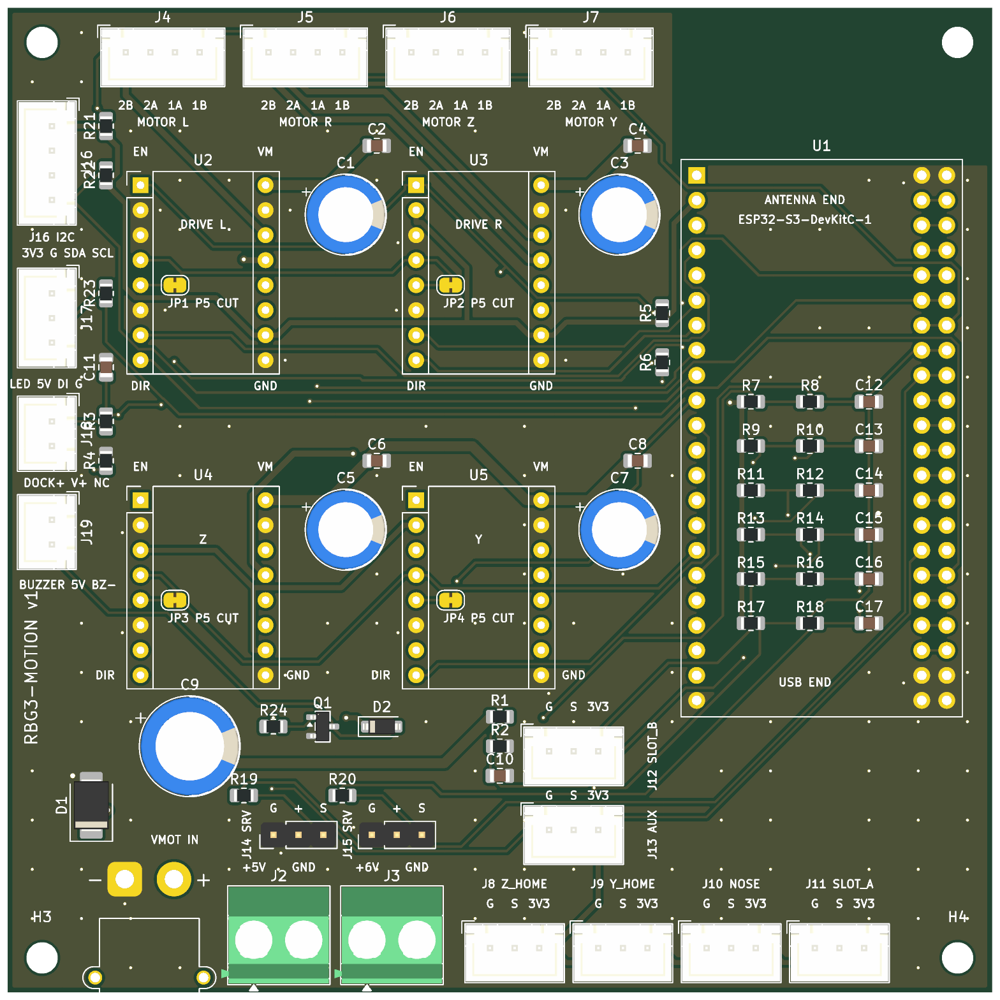
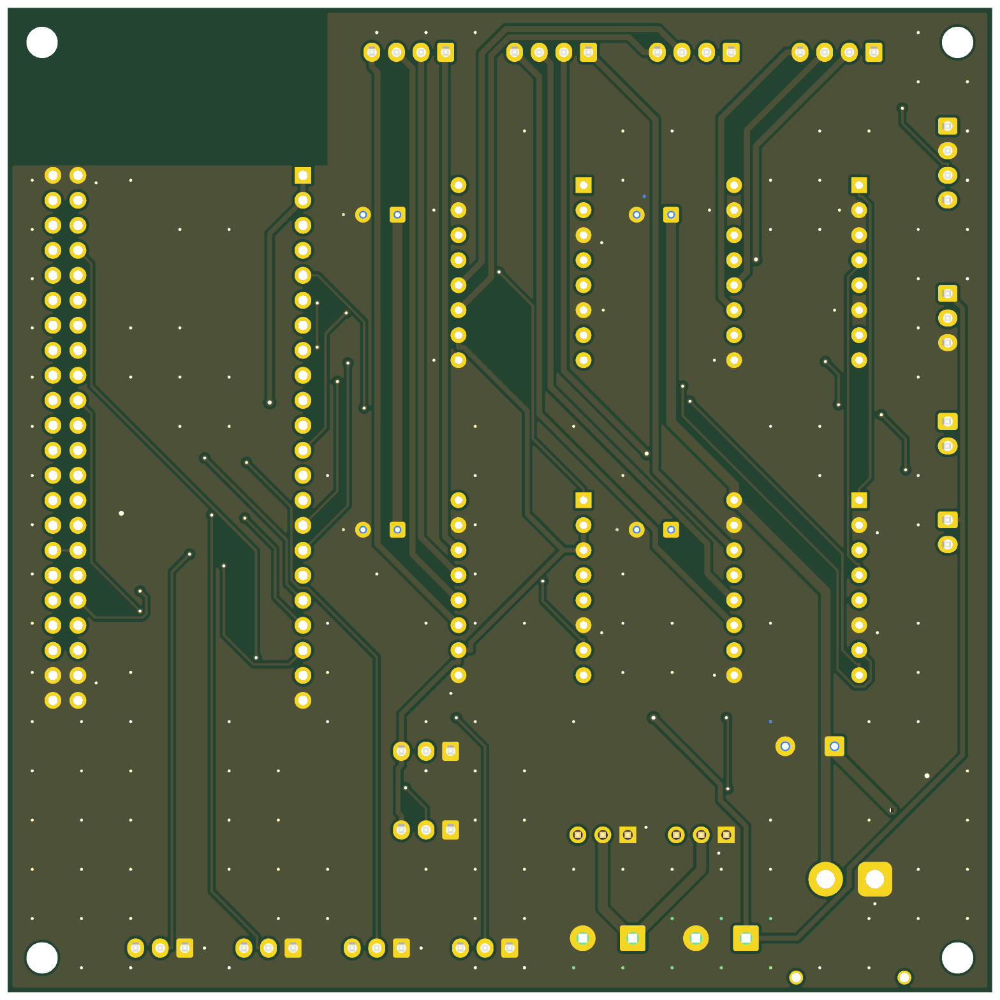

# Electrical design review: RackBotGen3 robot (spec v0.1.19)

Thanks for taking a look. This is a student robot for Delta Cup 2026: a small 4-stepper mobile robot that swaps
3.5" drive caddies in a rack. **About an hour of your time is plenty.** The questions below are where a second
opinion helps most. Anything else you spot is welcome too.

**Timing:** the motion PCB goes to JLCPCB (2-layer, 100 × 100 mm, 1 oz) as soon as the review is back, so
PCB comments are the most urgent.

## What to look at

| What | File |
|---|---|
| Schematic (PDF) | [`pcb/motion-board/fab/rbg3-motion-schematic.pdf`](../../pcb/motion-board/fab/rbg3-motion-schematic.pdf) |
| Gerbers (zip) / KiCad 10 project | [`fab/rbg3-motion-gerbers.zip`](../../pcb/motion-board/fab/rbg3-motion-gerbers.zip) / [`pcb/motion-board/`](../../pcb/motion-board/) |
| Board README (connectors, assembly, bring-up) | [`pcb/motion-board/README.md`](../../pcb/motion-board/README.md) |
| Electrical spec (power, pin map, connectors) | [`docs/spec/02-electrical.md`](../spec/02-electrical.md) |
| Datasheet cross-check already done | [`docs/datasheets/CROSSCHECK.md`](../datasheets/CROSSCHECK.md) |

| Top | Bottom |
|---|---|
|  |  |

## The system in one paragraph

- **Battery.** 4S1P 18650 Li-ion (12.0–16.8 V, ≈ 50 Wh), with a 4S BMS (common port). A 7.5 A blade fuse
  sits first, at P+, then the main switch, then an INA226 (10 mΩ shunt) feeding the main bus.
- **Charging.** On the dock, 24 V comes in through pads → SS54 → an XL4015 CC/CV module (16.8 V / 1.5 A) → the
  main bus. The pack charges through the BMS. The dock's − connects only to the charger's IN−, because the module
  senses current with a shunt between IN− and OUT−.
- **E-stop.** The NC button switches the coil of a 12 V automotive relay, whose contact cuts **VMOT** (steppers
  and servo buck). Logic stays powered.
- **Motion board.** Purely a carrier: an ESP32-S3-DevKitC-1, 4 × TMC2209 StepStick sockets (one shared
  single-wire UART, addresses set by MS1/MS2), JST-XH motor and switch connectors, an SMBJ18A TVS and
  470 µF bulk capacitance at the VMOT input (XT30), and 100 µF + 100 nF per driver. It has no regulators: 5 V
  (Pi + LEDs) and 5.8 V (servos) come from off-board buck modules on screw terminals.
- **Power draw.** Idle ≈ 4 W; moving ≈ 12–20 W. Run currents 1.0 / 1.0 / 0.9 / 0.6 A rms per motor.
- **Copper.** VMOT/GND/+6V_SERVO 1.0 mm, motor phases 0.6 mm, 3V3/5V 0.5 mm, signals 0.25 mm, GND pour on both
  layers.

## How this design has been verified so far

1. **KiCad checks** (`pcb/motion-board/scripts/build.sh`, which rebuilds the layout from scratch):
   - ERC: 0 violations.
   - DRC with `--schematic-parity`: 0 unconnected nets and 0 schematic/board mismatches. 19 cosmetic
     warnings remain (silkscreen overlaps, library footprint mismatches).
   - The autorouter result is kept only with 0 unrouted nets and 0 violations.
   - This shows that the board matches the schematic and meets JLCPCB's clearance rules. It doesn't show that
     the schematic is right.
2. **Datasheet cross-check** ([`CROSSCHECK.md`](../datasheets/CROSSCHECK.md)). Every electrical value in the
   spec, PCB and firmware was checked against a datasheet stored in the repo, with page numbers. It found and
   fixed:
   - UART on StepStick pin 5, not 4, on the MKS module;
   - the PSRAM pins are 33–37;
   - fuse 10 A → 7.5 A;
   - ADC full scale 19 V, not 20 V.
3. **SPICE simulations** ([`pcb/motion-board/sim/`](../../pcb/motion-board/sim/README.md), ngspice, re-run with
   `sim/run.sh`). Covered:
   - battery hot-plug onto VMOT;
   - E-stop with the drivers carrying current;
   - charger backfeed with the dock unpowered;
   - the ADC dividers and the UART.

   All pass. Two results need checking on the bench: the inrush (120–220 A for ≈ 100 µs, which might trip
   the BMS), and the slow E-stop detection when the drivers are disabled.
4. **Hand calculations** in spec 02: power budget, dividers, battery Wh, relay coil.
5. **Reviews by AI agents, not people.** The v0.1.6 "independent review" and a re-check of CROSSCHECK were each
   done by a separate AI agent with no shared context. **You are the first human reviewer.**

**Not done:** trace temperature rise (IPC-2152; widths are rules of thumb), any test on the bought modules,
and any hardware. Nothing has been built or powered yet. The step-by-step bring-up plan, which stops at the
first failure, is in the board [README](../../pcb/motion-board/README.md) ("Assembly and bring-up checklist").

## Questions

### Power and safety (spec 02 §1, §5)
1. **Charger topology.** Is it sound to run a CC/CV buck into the main bus, so it feeds the loads and charges the
   pack through a common-port BMS, while the robot is running? Is anything missing, such as a diode or ideal
   diode, to stop the bus backfeeding the charger when the dock power is off?
2. **Charger grounding.** Is connecting dock − only to the charger's IN− enough? Is there a failure mode we
   missed, such as a chassis contact touching the dock frame?
3. **Fuse and BMS.** Is a 7.5 A blade fuse at P+ with a ≥ 15 A BMS reasonable, given that normal draw is under 2 A
   and the cells are rated 8–10 A max?
4. **E-stop.** Is a relay contact cutting VMOT with the TMC2209s enabled acceptable? Should the firmware disable
   the drivers first, or is the TVS plus bulk capacitance enough to absorb the motor energy?

### Motion PCB (spec 02 §3)
5. **TVS margin.** The SMBJ18A clamps at 29.2 V at full pulse current, which equals the TMC2209's 29 V operating
   limit (32 V absolute max). Keep it, or move to the SMBJ17A (27.6 V)?
6. **Reverse polarity.** The only protection is the keyed XT30 plus the TVS and fuse; there is no series P-FET.
   Acceptable for a one-off v1?
7. **Copper widths.** VMOT 1.0 mm at about 4 A peak, and +6V_SERVO 1.0 mm carrying up to 3 A of servo stall
   current on 1 oz copper. Enough, or widen or pour?
8. **Grounding.** Motor return currents and logic share the GND pours. Does the layout (drivers on the left,
   ESP32 on the right, VMOT entering bottom-left) look OK?
9. **Decoupling.** Is 100 µF / 35 V + 100 nF per driver plus 470 µF bulk enough at these currents?
10. **UART.** Single-wire UART to 4 drivers: ESP TX through 1 k, RX direct, PDN_UART on pins 4 and 5 (JP1–JP4
    bridged). Any concern?
11. **ESP32 pins.** Strapping pins 0/3/45/46 and the octal-PSRAM pins 33–37 are avoided (pin map in spec 02 §3.1).
    The ADC dividers are 100 k / 18 k for VMOT (≈ 19 V full scale) and the dock sense. Any issue?
12. **Manufacturability.** Footprints, silkscreen or JLCPCB rules: anything that would bite on a first order?

## Out of scope (verified on the bought parts instead)
These are checked by measuring the parts when they arrive:
- the XL4015 module's shunt position;
- the XT30 polarity marks;
- the ESP32 header spacing;
- the relay coil current;
- the MKS TMC2209 R8 resistor.

They are listed in [`docs/BACKLOG.md`](../BACKLOG.md).

Please reply with comments numbered to the questions, or as a GitHub PR review.
