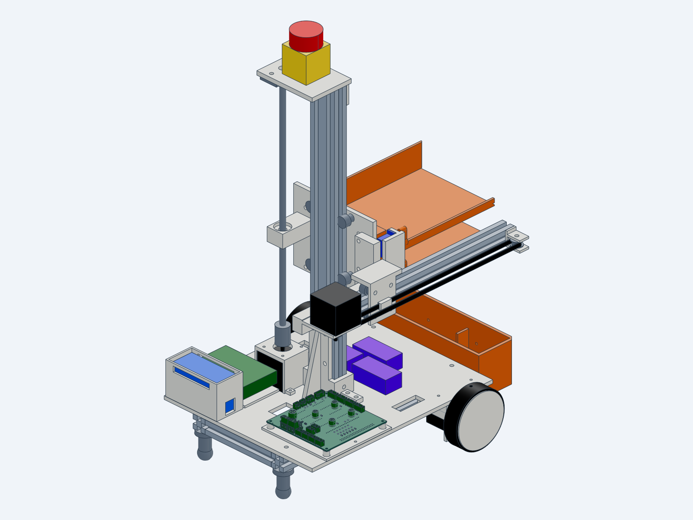
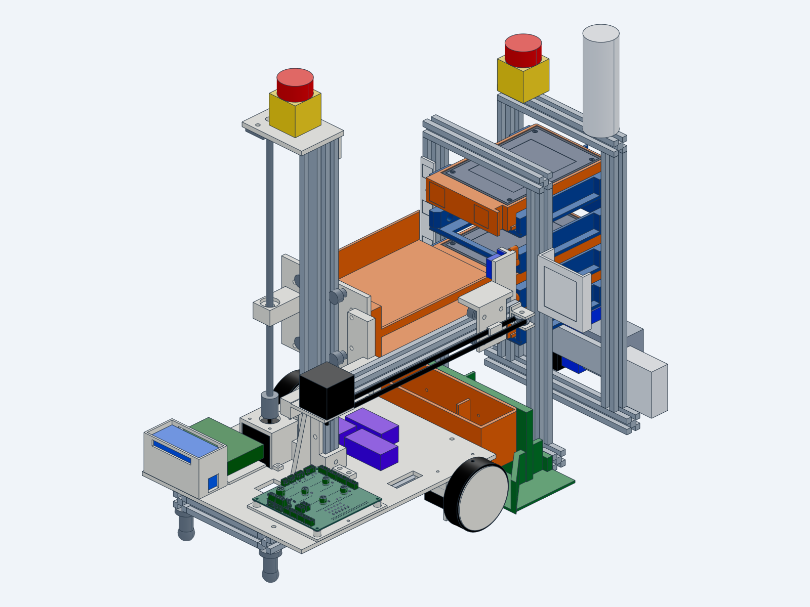

# Mechanical design review: RackBotGen3 robot (spec v0.1.19)

A short review is plenty (≈ 30 min). The robot is mostly 3D-printed (PETG/TPU) on 2020/2040 V-slot, so most
mistakes are cheap to reprint. The questions focus on what isn't cheap to fix: loads on bought parts and
stability.

| What | File |
|---|---|
| Mechanical spec (robot is §6) | [`docs/spec/01-mechanical.md`](../spec/01-mechanical.md) |
| CAD sources (build123d) and checks | [`cad/src/`](../../cad/src/), [`cad/checks/robot_check.py`](../../cad/checks/robot_check.py) |
| STEP files | Build outputs, not in git: ask for `robot_assembly.step` (sent separately), or rebuild with `PYTHONPATH=src python src/robot/<part>.py` inside `cad/` (needs cadgen) |

| Robot | Docked at the rack |
|---|---|
|  |  |

## The robot in one paragraph

- **Size and weight.** 300 W × 360 L, ≈ 545 mm tall, 4.45 kg empty; it carries up to 2 caddies with a design load of
  1.0 kg each.
- **Base.** Differential drive with Ø80 printed wheels (TPU tire on a PETG hub) **directly on the NEMA17 shafts**,
  2 rear ball casters plus a front anti-tip caster.
- **Z lift.** A 2040 mast with a V-wheel carriage on a Tr8×2 lead screw (KFL08 bearing on top, flexible coupler at
  the motor).
- **Y extractor.** A GT2 belt-driven V-wheel carriage on a 2020 rail, with MG90S servo fingers that hook into
  the caddy handle.
- **Already checked by script.** `robot_check.py` checks clearances over 42 poses, the full pull/push strokes,
  sight lines, mass, centre of gravity and tip-over.

## Questions
1. **Drive shaft radial load (spec 01 §6.2).** ≈ 21 N static per wheel, at about 18 mm from the motor flange,
   against the JK42HS40 rating of 28 N at 20 mm. The hub is set at a 2 mm gap from the bracket plate with a shim,
   and the set screw goes onto the D-flat. Is direct drive acceptable for a few hours of demo running, or should
   we add an outboard bearing now?
2. **Tip-over (01 §6.1).** With 2 caddies at full lift, the centre of gravity is 69 mm behind the drive axle,
   145 mm ahead of the rear casters and 63 mm from the side edge, at 0.3 m/s² braking. Is this margin enough for
   a robot that is accelerated by a stepper?
3. **Z lift (01 §6.3).** The mast is a 2040 × 420 standing on a cross member with a printed collar and gusset.
   Is it stiff enough for a 2 kg load (2 caddies) at about 300 mm height? Is the Tr8×2 lead screw (self-locking with a dry
   POM nut) OK with only a flange bearing at the top and a flexible coupler at the bottom?
4. **Y extractor (01 §6.5).** The V-wheel carriage on a 2020 rail is clamped through the tray screws, with a
   GT2 belt and a slotted idler for tension. Is anything likely to rack or slip when pulling a caddy (up to 1.0 kg,
   sliding on a PETG shelf)?
5. **Printed parts.** Are any parts likely to crack or creep in PETG? The drive hub, drive bracket, mast collar
   and rail bracket carry the main loads.

Please reply with comments numbered to the questions, or as a GitHub PR review.
