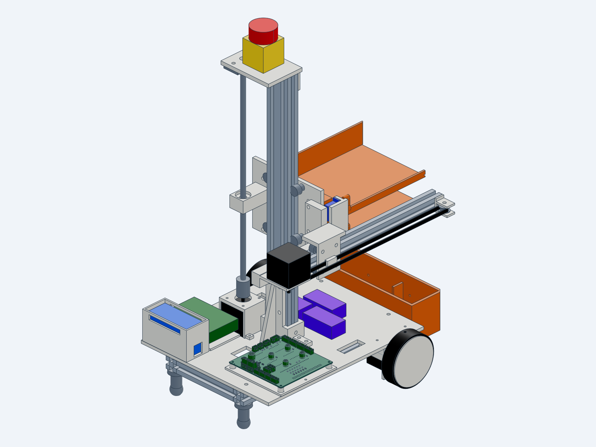
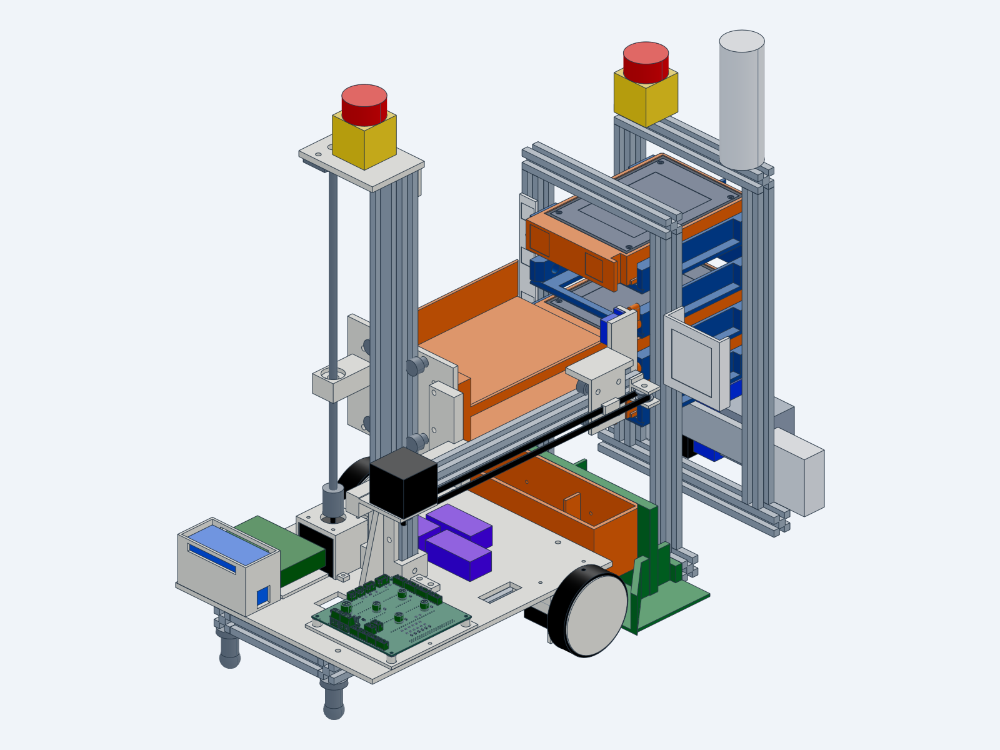

# RackBotGen3: project overview

Delta Cup 2026, Automation track. Regional final in Thailand, 14 Nov 2026. Student team of 4.

## Objective

A proof-of-concept **autonomous hot-swap robot for data-center drive maintenance**. When the monitoring
dashboard reports a failing drive, a small mobile robot, which waits and charges at a spare station:

1. picks a spare 3.5" drive caddy from the spare station;
2. drives to the rack and docks;
3. pulls the failed caddy and pushes the spare into the same bay;
4. drives back to the spare station and puts the failed drive in its RMA slot;
5. stays docked there and charges until the next job.

The pitch is lights-out data centers: no technician trip per failed drive, and a shorter window with a degraded
RAID. Delta hardware is inside: a Delta PLC does the rack I/O and safety, and a Delta PSU powers the rack and the
charging dock. Target: **≤ 3 min per full swap** and **≥ 95 % success over 50 cycles**.

| Robot | Docked at the rack |
|---|---|
|  |  |

## The robot

- **Size.** 300 × 360 mm footprint, ≈ 545 mm tall, ≈ 4.5 kg. Built from 2020/2040 V-slot and 3D-printed parts.
- **Motion.** 4 NEMA17 steppers: 2 direct-drive wheels (differential drive), a Z lift on a lead screw and a Y
  extractor on a belt. 2 micro servos swing fingers into the caddy handle to pull or push it.
- **Tray.** 2 slots stacked at the bay pitch (45 mm), so one visit to the rack both pulls the failed caddy and
  inserts the spare.
- **Docking.** A camera finds AprilTags on the rack and spare station; a mechanical V-funnel gives ±2 mm
  repeatability; spring contacts on the spare-station dock (the robot's home) charge the battery.
- **Compute.** A Raspberry Pi 3 runs vision, the mission logic and the web dashboard. It talks over USB serial
  to the **motion board**, which generates the steps in real time.
- **Power.** 4S Li-ion pack (≈ 50 Wh, airline carry-on safe) with a BMS, fuse, current monitor and an E-stop
  relay that cuts motor power.

## Where the motion board fits

The motion board (RBG3-MOTION, the subject of this review) is a 2-layer 100 × 100 mm carrier board on the robot
base. It holds:

- an ESP32-S3 DevKit (the motion controller);
- 4 TMC2209 stepper driver modules, one per motor;
- connectors for the motors, servos, limit and presence switches, LED, buzzer and current monitor;
- battery-voltage and dock-voltage sensing, and surge protection on the motor supply.

It has no regulators of its own: 5 V and the servo supply come from off-board buck modules. The following pages
give the review brief and questions, then the schematic, layout, 3D renders and supporting documents.

## Constraints that shaped the design

- About 5 weeks from design to a tested robot (10 Nov 2026), so off-the-shelf modules wherever possible.
- Total budget ≤ 500 USD (estimate ≈ 480 USD).
- Everything must travel as carry-on luggage (7 kg per bag), which also limits the battery to < 100 Wh.
- One-off build: the PCB is ordered from JLCPCB, small surface-mount parts assembled by JLCPCB, and the
  through-hole parts hand-soldered.
