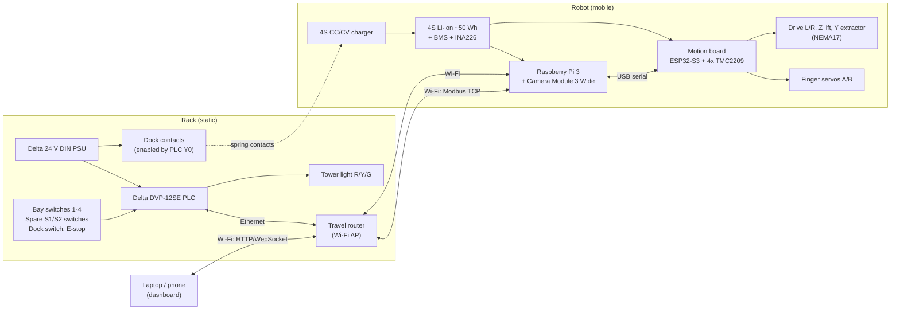

# RackBotGen3 — System Overview

Delta Cup 2026 · Automation track · Regional Final, Thailand, 14 Nov 2026
Status: **Draft v0.1.9 (7 Oct 2026)** — single owner for all subsystems; peers review and give feedback.

| Doc | Content |
|---|---|
| [00-overview.md](00-overview.md) | Goals, constraints, demo workflow, architecture, weight & packing budget |
| [01-mechanical.md](01-mechanical.md) | Caddy, dummy drive, rack, spare station, robot base, Z lift, Y extractor, tray |
| [02-electrical.md](02-electrical.md) | Power tree, motion board, pin map, rack/PLC I/O, networking |
| [03-software.md](03-software.md) | Software architecture, serial protocol, Modbus map, mission state machine, vision, dashboard |
| [04-plan-budget-risk.md](04-plan-budget-risk.md) | BOM & budget, schedule, test protocol, risks, airline packing checklist |

---

## 1. Goal

A proof-of-concept **autonomous hot-swap robot for data-center drive maintenance**. When the monitoring
dashboard reports a failing drive, a small mobile robot fetches a spare caddy from a spare station,
drives to the rack, pulls the failed 3.5" caddy, inserts the spare, verifies it, and returns the failed
drive to an RMA slot. Then it docks and charges.

Pitch angle (judging: Innovation, Technical Viability, Impact & Sustainability, Communication):
- **Lights-out data centers**: no technician walk or truck roll per failed drive, shorter degraded-RAID window.
- **Delta inside**: a Delta PLC does rack I/O and safety, and a Delta PSU powers the rack and the charging dock.
- **Energy-aware**: measured Wh per swap, the robot sleeps on the dock, and the dashboard reports energy.

## 2. Constraints

| # | Constraint | Design response |
|---|---|---|
| C1 | Built and tested by **10 Nov 2026** (about 5 weeks) | Off-the-shelf modules, 4 steppers with a single driver type, Python on the Pi, mechanical docking instead of precision navigation |
| C2 | **≤ 500 USD** | Est. ≈ 497 USD (see 04). Delta PLC loaned or sponsored, with an ESP32 fallback |
| C3 | Manufacturable with a 400×400 mm FDM printer, grinder and drill press | 2020/2040 V-slot cut to length, printed plates/brackets; no machining beyond cutting and drilling |
| C4 | **Carry-on, 7 kg per bag, 4 members** | Flat-pack rack, removable mast; ≈ 14 kg of hardware over 4 bags (≈ 50 % margin) |
| C5 | Airline safety | Li-ion pack **≈ 50 Wh (< 100 Wh)**, in cabin, terminals protected; universal-input Delta PSU (Thailand 220 V / 50 Hz) |
| C6 | Must include **machine vision, IIoT dashboard, Delta hardware** | AprilTag docking and caddy ID, FastAPI web dashboard, Delta DVP-12SE PLC and Delta 24 V PSU |
| C7 | 3.5" HDD payload | Printed caddy plus ballasted dummy drive (≈ 750 g together); design load 1.0 kg per caddy |

## 3. Key design decisions

| Decision | Choice | Why |
|---|---|---|
| Robot type | Differential-drive mobile base + Z lift + Y extractor | Proposal commitment; shows mobility |
| Rack | 1 column × 4 bays + separate 2-slot spare station | Simplest geometry that still shows a full swap workflow |
| Tray | **2 slots stacked vertically at bay pitch (45 mm)**, slot selected by the Z lift | Pulls the failed caddy and inserts the spare in one visit, with no extra actuator (replaces the lateral shuttle in the plan) |
| Gripping | Fingers swing down (servo axis along the travel direction) into a side notch in the caddy handle block; one finger both pulls and pushes, and holds the caddy during driving | One mechanism, no clamping force; nothing passes the rack face |
| Docking | Vision approach (AprilTag) + **mechanical V-funnel** + dock switch | Funnel gives ±2 mm repeatability without precise odometry |
| Caddy | 3D-printed, own design, real 3.5" drive envelope | No latch to work, tags built in, no shipping risk |
| Compute | Raspberry Pi 3B/3B+ (owned) + ESP32-S3 motion controller | Pi does vision, logic and web; ESP32 does real-time step generation |
| Actuators | 4× NEMA17 on TMC2209 (2 direct-drive wheels, Z, Y) + 2 micro servos | One driver type, open-loop steps are repeatable, quiet; no belts on the drive |
| Rack controller | Delta DVP-12SE PLC over Modbus TCP | Delta hardware; industrial pattern (PLC = I/O and safety, PC = planning) |

## 4. Coordinate system & naming

Viewed from in front of the rack:
- **X**: left/right along the rack face (robot drives / turns on the floor)
- **Y**: in/out of the bay (extractor stroke, + toward the rack)
- **Z**: up/down (lift), measured from the floor/table surface
- Bays numbered **1 (bottom) → 4 (top)**. Spare station slots: **S1 = GOOD** (bottom), **S2 = RMA** (top).
- Tray slots: **B = lower**, **A = upper** (A = B + 45 mm).

## 5. Demo arena

Fits a table of at least **1.2 m × 0.6 m** (a floor works too). The rack and spare station face each other, about 700 mm apart.

```
  +---------------------------------------------------------------+
  |                                                               |
  |  [SPARE STATION]  <-------- ~700 mm --------->  [RACK 1x4]    |
  |   S2 RMA / S1 GOOD        robot path           bays 1-4       |
  |   tag 10              [ROBOT] (turns 180°)     tag 0, dock    |
  |                                                Delta PLC+PSU  |
  +---------------------------------------------------------------+
               table / mat >= 1200 x 600 mm
```

## 6. Swap workflow (happy path)

1. The dashboard marks **bay N = FAILED** (simulated SMART fault, or operator button). A swap job is queued.
2. The robot undocks from the rack (reverses 250 mm), turns 180° and approaches the spare station using tag 10, then funnel-docks.
3. **Pick spare**: aligns slot A with S1, extends Y, engages finger A, retracts. The spare is now in slot A, held by the finger.
4. Undocks, turns 180°, approaches the rack using tag 0 and docks. The PLC confirms the dock switch.
5. **Extract**: aligns slot B with bay N and reads the caddy tag (checks the ID matches the job). Extends, engages finger B, retracts. The PLC sees bay N empty.
6. **Insert**: lowers Z by 45 mm so slot A (the upper slot) is level with bay N, extends (pushing the spare in), releases finger A, retracts. The PLC sees bay N occupied, and the dashboard shows bay N OK with the new caddy ID.
7. **Return RMA**: drives to the spare station, aligns slot B with S2, pushes the failed caddy in, releases and retracts.
8. Returns to the rack dock. Dock power is enabled by the PLC and the robot charges. The job is closed with cycle time and Wh used.

Target: **≤ 3 min per full swap cycle**, **≥ 95 % success over 50 cycles** (see 04 test protocol).

## 7. System architecture



## 8. Weight & packing budget

Per-person carry-on limit is 7 kg (bag size ≈ 56 × 36 × 23 cm). The hardware budget below leaves room for personal items.

| Item | Mass (kg, est.) | Packs as |
|---|---|---|
| Robot base (frame, plates, 2 drive motors, wheels, casters, bumper) | 2.3 | 1 piece, ≈ 300 × 300 × 130 mm |
| Mast + Z lift + Y extractor + tray + camera (removable unit) | 1.6 | 1 piece, ≈ 450 × 200 × 120 mm |
| Robot electronics (motion board, Pi, wiring) | 0.4 | Mounted on base |
| Battery pack 4S ≈ 50 Wh (**cabin, own pouch**) | 0.35 | LiPo bag |
| Rack frame (flat-packed) + printed shelves + dock block | 1.7 | Uprights 320 mm |
| Rack electronics (Delta PSU, PLC, DIN rail, tower light, E-stop, router) | 1.0 | Padded box |
| Spare station (2020 frame + 2 shelves + dock block) | 1.3 | Uprights 215 mm |
| Caddies + dummy drives × 6 (≈ 0.75 each) | 4.5 | 1–2 per bag |
| Table mat, tools (carry-on legal), spares, cables | 2.0 | Split |
| **Total** | **≈ 15.2** | vs 28 kg allowance → ≈ 45 % margin |

Suggested split: Bag 1 robot base + electronics + battery (≈ 3.1 kg) · Bag 2 mast unit + 2 caddies (≈ 3.1 kg) ·
Bag 3 rack frame + rack electronics + 1 caddy (≈ 3.5 kg) · Bag 4 spare station + 3 caddies + mat/tools (≈ 5.6 kg; move tools to bag 1 if personal items need room).
Weigh every bag in week 5 (see 04).

## 9. Open questions

1. ~~Subsystem owners~~ — resolved: one owner for all subsystems; peers act as reviewers.
2. Can Delta Thailand lend a DVP-12SE (or similar SE/SS2 with Ethernet)? Ask this week. If not, use the ESP32 rack fallback.
3. Do we have broken 3.5" HDDs (IT department, repair shop, e-waste)? Use 1–2 for the show, dummies for the rest.
4. Team-owned parts to reuse (Pi 3, steppers, filament, router, fasteners) — this frees budget.
5. Will the final demo be on a table or the floor? This affects the mat and edge safety.

## 10. Revision history

| Version | Date | Change |
|---|---|---|
| v0.1 | 2026-10-05 | Initial spec: concept, mechanical, electrical, software, plan/budget/risk |
| v0.1.1 | 2026-10-06 | Ownership recorded (single owner, peer review); CAD started for caddy, dummy drive, bay shelf |
| v0.1.2 | 2026-10-06 | Rack + spare station CAD: dock stop moved in front of the rack (y = −30), approach tag on the right upright, real frame lengths and masses |
| v0.1.3 | 2026-10-06 | Motion board v1 in KiCad (`pcb/motion-board`): buck modules off-board, hard-wired driver addresses, XT30 polarity, AUX input on GPIO38 |
| v0.1.5 | 2026-10-06 | Y belt drive modeled: motor shaft-down behind the rail end, 20T pulley, idler fork, carriage belt clamp; robot 4.52 kg |
| v0.1.6 | 2026-10-06 | Independent review fixes. **Mech:** idle finger parked during Y strokes; 10 mm fingers (±1 mm play), Y pull/seat/push 177/178/178.5, hard stop 187; gantry V-wheel carriages (Z in mast side grooves, Y above/below the rail); rail bracket clamped by 3 tray screws; tray screws from behind into inserts; mast on its cross member + collar socket/gusset; KFL08 (not KP08); Z-motor mount; battery box 2 × 2 cells; 3 module spaces; caster gap 6.5; stricter checks (≥ 1 mm running clearance, full strokes). **Elec:** XT30 J1 turned to the board edge, SMBJ18A TVS at J1, J12/J13 out of the USB plug path, R2 18 k, +6 V trace 1.0 mm, separate PTH/NPTH drill files, dock sense before SS54, fuse first, charger IN−-only grounding, NC home switches, TMC re-init after E-stop. **Parts:** 6 m of 2020, KFL08, fastener counts, 90° USB-C cable (P37), INA226 R010; budget ≈ 491 USD; robot 4.45 kg |
| v0.1.7 | 2026-10-06 | Mast top plate tab bolts into both front slots of the 2040 (2 × M5 at x = ±10; the single bolt at x = 0 missed the slots), E-stop box on 2 × M3 inserts. Parts: M5 heat-set inserts (~15) and M5×16/×25 tray bolts added to P11 (25 → 28 USD); budget ≈ 494 USD. Fit-test coupons (`docs/fit-test-01.md`) |
| v0.1.8 | 2026-10-06 | Robot E-stop drives a 12 V automotive relay (coil through the NC button, contact cuts VMOT) instead of breaking motor current in the button; fail-safe on a broken wire. New P38 (3 USD); budget ≈ 497 USD |
| v0.1.9 | 2026-10-07 | Software started: Pi application (`rackbot/`, sim mode) and motion firmware (`firmware/motion/`). 03 §3 completed from the implementation: `E_STOPPED`, `STATUS` reply, `busy` letters, extra events (`BOOT`, `DRIVER_RESET`, `SLOT_A/B`, `BADLINE`), `CFG` keys, busy/homed rules; §8 homing, E-stop recovery timing, LED. No parts change |
| v0.1.4 | 2026-10-06 | Robot CAD v0 + checks: direct drive (axle y −135), nose z 30–90, swing-down fingers, tray camera window, caddy tag moved left, E-stop on the mast top; mass 4.49 kg; budget ≈ 478 USD |
