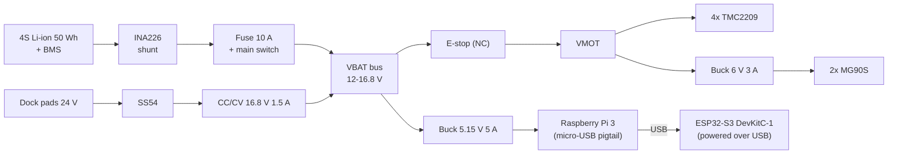

# RackBotGen3 — Electrical Specification

Status: Draft v0.1. The motion board (§3) is the KiCad deliverable. Everything else uses off-the-shelf modules and wiring.

---

## 1. Robot power

| Item | Spec |
|---|---|
| Battery | **4S1P 18650**, 3.5 Ah cells (e.g. Samsung 35E / LG MJ1), 14.4 V nominal, 16.8 V full, 12.0 V cutoff → **50.4 Wh** (airline < 100 Wh) |
| BMS | 4S, ≥ 15 A, common port (charge and discharge on the same P+/P−), balancing |
| Main fuse / switch | 10 A blade fuse + 10 A rocker switch at the battery box |
| E-stop | Robot mushroom (NC, ≥ 10 A) cuts **VMOT only** (steppers and servos). Logic stays alive to report the E-stop. The Z lead screw is self-locking, so the load cannot drop |
| Energy meter | **INA226** module (10 mΩ shunt, ±8 A) between battery+ and the main bus. **+ current = discharge, − = charging** |
| Charging | Dock pads → Schottky (SS54) → **CC/CV buck (XL4015-type) set 16.8 V / 1.5 A** → main bus (feeds loads + charges through the BMS). Full charge ≈ 2.5 h; the dock also tops up between demo runs |
| Dock sense | Dock pad voltage divider → ESP32 ADC (`DOCK_V`). Charger present = docked and PLC enabled dock power |

Power estimate: idle ≈ 4 W (Pi + logic), moving ≈ 12–20 W. **≈ 0.6–1.0 Wh per 3-min swap**, so a full battery lasts ≈ 2.5 h of continuous cycling.

Wire: battery/VMOT 18 AWG, motors 22–24 AWG, signals 26 AWG. Connectors: XT60 at the battery, XT30 to the board, JST-XH for motors and switches.

## 2. Compute & motion control

- **Raspberry Pi 3B/3B+**: Raspberry Pi OS Lite 64-bit, headless. Camera Module 3 Wide on CSI (500 mm flex). USB to the ESP32 (serial). Wi-Fi client on the rack network.
- **ESP32-S3-DevKitC-1** (N8 or N16, no octal PSRAM required) plugged into the motion board. **Powered over USB from the Pi.** The DevKit 5V pin is *not* connected to the board 5 V (prevents backfeed).
- **4 × TMC2209 StepStick** (e.g. BTT v1.3), one shared single-wire UART, VIO from ESP32 3V3 (drivers disabled if the ESP32 is unpowered).

| Driver | UART addr (MS1/MS2) | Motor | Run current (rms) | Microsteps |
|---|---|---|---|---|
| U1 | 0 | Drive left | 1.0 A | 16 (interpolated) |
| U2 | 1 | Drive right | 1.0 A | 16 |
| U3 | 2 | Z lift | 0.9 A (hold 0.5 A) | 16 |
| U4 | 3 | Y extractor | 0.6 A | 16 |

## 3. Motion board (KiCad PCB)

Two-layer module carrier, **100 × 100 mm**, 1 oz copper, 4 × M3 holes at 93 × 93 pitch.
Ordered from JLCPCB **by 14 Oct**. The same schematic can be built on perfboard as a fallback.
**Implemented in `pcb/motion-board/`** (KiCad 10, ERC/DRC clean; see its README for the pre-order checklist).
As built: VMOT/GND traces 1.0 mm + GND pours on both layers, motor traces 0.6 mm, supplies 0.5 mm, signals 0.25 mm.

### 3.1 ESP32-S3 pin map

| GPIO | Signal | Dir | Notes |
|---|---|---|---|
| 4 / 5 | DRV_L_STEP / DRV_L_DIR | out | |
| 6 / 7 | DRV_R_STEP / DRV_R_DIR | out | |
| 15 / 16 | Z_STEP / Z_DIR | out | |
| 17 / 18 | Y_STEP / Y_DIR | out | |
| 8 | STEPPER_EN_N | out | Shared, active low, 10 k pull-up to 3V3 (disabled at boot) |
| 9 | TMC_UART_TX | out | Through 1 k to the single-wire PDN_UART bus |
| 10 | TMC_UART_RX | in | Direct to the bus |
| 1 | VMOT_SENSE | ADC | 100 k / 22 k divider (16.8 V → 3.03 V). Below 9 V means E-stop pressed or VMOT off |
| 2 | DOCK_V_SENSE | ADC | 100 k / 10 k divider (24 V → 2.18 V) |
| 11 | Z_HOME | in | Switch to GND, active low |
| 12 | Y_HOME | in | " |
| 13 | NOSE | in | Nose dock switch (both stations) |
| 14 | SLOT_A | in | Tray slot A presence |
| 21 | SLOT_B | in | Tray slot B presence |
| 39 | SERVO_A | out | Finger A, 330 Ω series |
| 40 | SERVO_B | out | Finger B, 330 Ω series |
| 41 / 42 | I2C_SDA / I2C_SCL | i/o | INA226 @ 0x40, 4.7 k pull-ups |
| 47 | STATUS_LED | out | WS2812 (external), 330 Ω series |
| 48 | BUZZER | out | Via NPN (onboard RGB on some DevKit revisions also on 48/38: harmless) |
| 38 | AUX_IN | in | Spare switch input J13 (onboard RGB LED on some DevKit revisions shares 38: harmless as an input) |
| — | Avoid | — | 0, 3, 45, 46 (strapping); 19/20 (USB); 43/44 (UART0); 35–37 (PSRAM) |

Switch inputs: internal pull-up + 10 k external pull-up to 3V3, 1 k series, 100 nF to GND (debounce/ESD).

### 3.2 Connectors

| Ref | Type | Pins |
|---|---|---|
| J1 VMOT | XT30PW-M (horizontal) | **pad 1 = GND (−), pad 2 = VMOT (+)** (after E-stop) |
| J2 5V_IN | 2-pin 5.08 screw terminal | +5 V, GND from the 5 V buck (which also feeds the Pi) |
| J3 6V_SERVO_IN | 2-pin 5.08 screw terminal | +6 V, GND from the servo buck |
| J_M1…J_M4 | JST-XH 4-pin | 2B, 2A, 1A, 1B (match the StepStick pinout) |
| J8…J13 | JST-XH 3-pin | GND, SIG, 3V3 (Z_HOME, Y_HOME, NOSE, SLOT_A, SLOT_B, AUX_IN on GPIO38) |
| J_SERVO_A/B | 2.54 3-pin header | GND, 6 V, SIG |
| J_I2C | JST-XH 4-pin | 3V3, GND, SDA, SCL |
| J_LED | JST-XH 3-pin | 5 V, DIN, GND |
| J_DOCK | JST-XH 2-pin | DOCK_V, GND |
| J_BUZ | 2-pin | Buzzer |

### 3.3 On-board parts

- 2 × 22-pin female headers for the ESP32-S3-DevKitC-1. The right row is drilled at both 22.86 mm and 25.4 mm
  spacing; fit the header in the row that matches the measured module.
- 4 × StepStick sockets (2 × 8 female headers). MS1/MS2 **hard-wired** per socket for UART addresses 0–3
  (no jumpers to forget). UART on StepStick pin 4 (PDN_UART); CLK tied to GND (internal clock).
- Per driver: 100 µF / 35 V electrolytic + 100 nF on VMOT. Bulk: 470 µF / 35 V at J_VMOT. **SMBJ24A TVS** on VMOT.
- Buck modules are **off-board** (vendor footprints vary): the 5 V/5 A buck feeds the Pi and J2 (5 V in), the
  6 V/3 A servo buck (from VMOT, after the E-stop) feeds J3. The board has no on-board regulators.
- WS2812 level: driven from 3V3 through 330 Ω (works for short leads). Optional 74AHCT1G125 footprint.
- Silkscreen: every connector labeled, polarity marks, board name `RBG3-MOTION v1`.

### 3.4 KiCad deliverables

Schematic, PCB layout, DRC/ERC clean, Gerbers + drill + BOM + position file (JLCPCB format), 3D STEP export (imported into the robot CAD to check fit).

## 4. Rack electrical (Delta)

### 4.1 Parts

| Item | Spec |
|---|---|
| **Delta 24 V DIN-rail PSU** | 24 V, **75–100 W**, universal 100–240 VAC input (Thailand 220 V / 50 Hz). Delta CliQ or Lyte series, exact part from distributor stock |
| **Delta DVP-12SE11T PLC** | 8 DI / 4 DO (NPN transistor), 24 VDC, built-in Ethernet, **Modbus TCP server**. Programmed with ISPSoft/WPLSoft |
| Dock power relay | 24 V relay module (≥ 5 A contact) driven by PLC Y0, + 3 A polyfuse on the dock + line |
| Tower light | Mini 3-color 24 VDC LED (R/Y/G), common + |
| E-stop | Mushroom NC, 2 contacts: one to PLC X5, one in series with the dock relay coil (hardware interlock) |
| Router | Travel router (e.g. GL.iNet GL-MT300N-V2) powered from 24 → 5 V USB buck; LAN to PLC, Wi-Fi AP `RACKBOT` |
| Terminal blocks | DIN rail terminal blocks for 24 V / 0 V distribution |

Power budget: PLC ≈ 5 W, light 3 W, router 3 W, robot charger ≈ 28 W → **≈ 40 W**, so a 75–100 W PSU gives margin.

### 4.2 PLC I/O map

| PLC I/O | Signal | Notes |
|---|---|---|
| X0 | Bay 1 caddy present | Lever switch, 24 V input |
| X1 | Bay 2 caddy present | |
| X2 | Bay 3 caddy present | |
| X3 | Bay 4 caddy present | |
| X4 | Rack dock switch | Robot nose fully docked |
| X5 | Rack E-stop OK | **NC**: 1 = OK, 0 = pressed |
| X6 | Spare S1 (GOOD) present | Cable to the spare station (≈ 1 m, 4-core) |
| X7 | Spare S2 (RMA) present | |
| Y0 | Dock power enable | Relay → dock contacts. **Interlock in ladder: Y0 = cmd AND X4 AND X5 AND watchdog OK** |
| Y1 | Tower GREEN | Idle / all bays OK |
| Y2 | Tower YELLOW | Swap in progress / degraded bay |
| Y3 | Tower RED | Fault / E-stop / Pi watchdog lost |

Input wiring: switches connect +24 V to Xn with S/S tied to 0 V (verify the sink/source naming against the DVP-SE manual before wiring).
Output wiring: lamp/relay coil between +24 V and Yn (NPN sinking). Flyback diode on the relay coil if the module has none.

The Modbus register map is in [03-software.md §4](03-software.md#4-rack-modbus-tcp-register-map).

### 4.3 Network

| Device | IP |
|---|---|
| Travel router (AP `RACKBOT`, WPA2) | 192.168.8.1 |
| Delta PLC | 192.168.8.10 (static, set in ISPSoft/DCISoft) |
| Raspberry Pi | 192.168.8.20 (static/DHCP reservation) |
| Dashboard clients (laptop/phone) | DHCP |

### 4.4 Fallback rack controller (if no PLC)

ESP32 DevKit + 8-ch 24 V optocoupler input board + 4-ch MOSFET output board on the same DIN rail.
The firmware exposes the **identical Modbus TCP register map** over Wi-Fi, so the Pi software does not change.

## 5. Safety summary

- Robot E-stop is a hard cut of VMOT. Rack E-stop is a hard cut of dock power, plus a PLC input → Pi stops the robot in software.
- PLC watchdog: if the Pi heartbeat register stops changing for 2 s → RED lamp and dock power off.
- Dock contacts are energized only while the robot is fully docked (X4) — no live 24 V exposed otherwise.
- Battery: BMS protection, fuse, XT60 removable. Never charge unattended. Charging is only via the CC/CV module.
