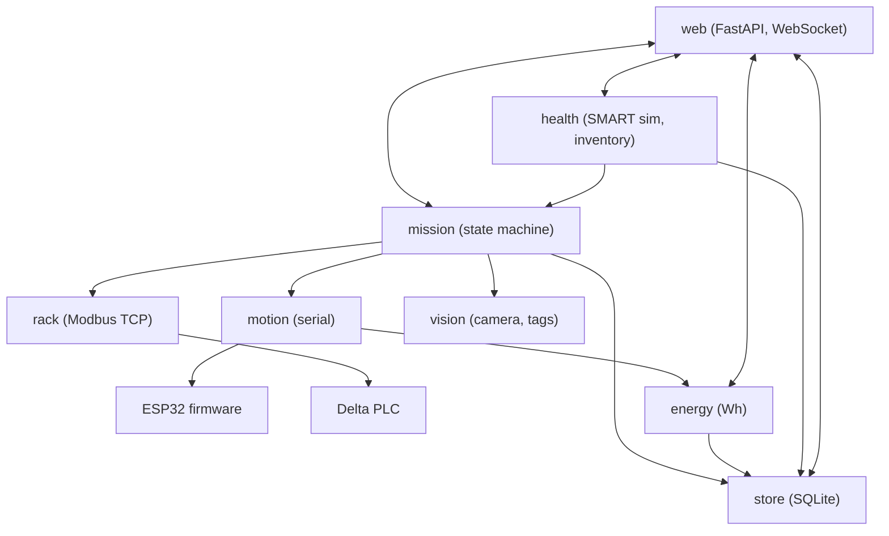
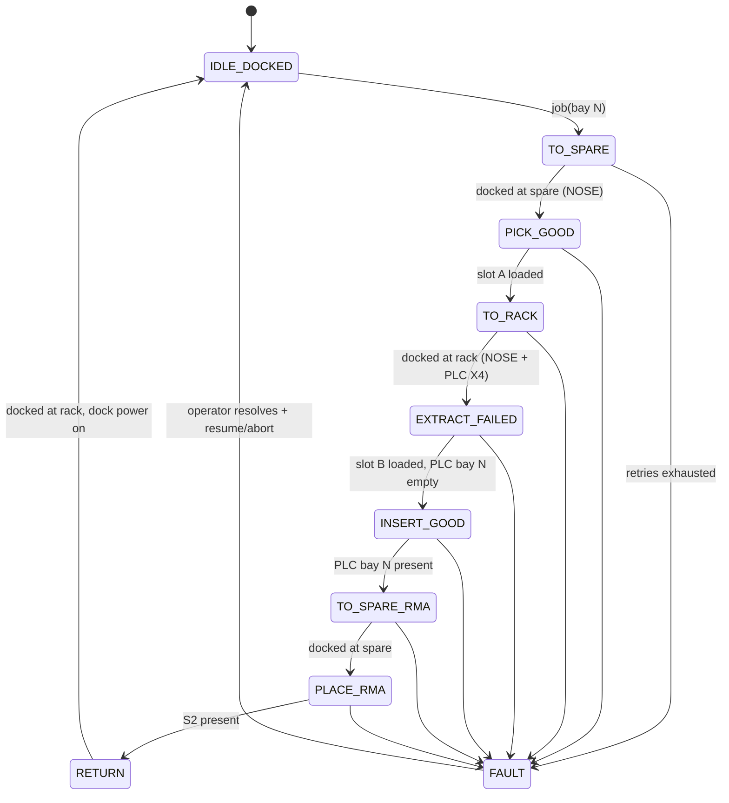

# RackBotGen3 — Software Specification

Status: Draft v0.1. Three programs: **Pi application** (Python), **motion firmware** (ESP32-S3), **rack PLC program** (Delta ladder).

---

## 1. Repository layout (target)

```
docs/spec/                    this specification
cad/                          text-to-cad sources: caddy, dummy_drive, shelf, rack, spare_station, robot/*
pcb/motion-board/             KiCad project (RBG3-MOTION v1)
firmware/motion/              PlatformIO project, ESP32-S3 motion controller
firmware/rack-fallback/       ESP32 Modbus TCP rack controller (only if no PLC)
plc/                          ISPSoft project + exported ladder listing
rackbot/                      Raspberry Pi application (Python 3.11)
  config.yaml                 geometry, calibration, network, tag IDs
  rackbot/
    main.py                   asyncio entry point (--sim for laptop development)
    motion.py                 serial client for the ESP32 protocol (§3)
    rack.py                   Modbus TCP client for PLC/fallback (§4)
    vision.py                 camera capture, AprilTag/QR, approach controller (§6)
    mission.py                swap-job state machine (§5)
    health.py                 simulated drive SMART model + inventory
    energy.py                 Wh integration from telemetry
    store.py                  SQLite (jobs, events, energy samples)
    web/                      FastAPI app + static dashboard (§7)
  tests/
tools/                        tag sheet generator, camera calibration, bench jog scripts
```

## 2. Pi application overview

- Raspberry Pi OS Lite 64-bit (Bookworm), Python 3.11, single **asyncio** process run as a systemd service.
- Dependencies: `fastapi`, `uvicorn`, `pyserial-asyncio`, `pymodbus`, `pyyaml`, `pupil-apriltags`, `picamera2` and `python3-opencv` (apt), optional `pyzbar`.
- **Sim mode (`--sim`)**: `MockMotion` (time-based kinematics), `MockRack` (in-memory registers) and recorded images for vision.
  Mission logic and the dashboard are developed on a laptop in weeks 1–2, before hardware exists.
- Pi 3 performance rules: 640×480 grayscale frames, AprilTag `quad_decimate=2`, no neural networks, the dashboard video stream limited to 320×240 at 5 fps.



## 3. Pi ↔ ESP32 serial protocol

USB CDC, 115200 8N1, ASCII lines terminated by `\n`.

- Request: `<seq> <CMD> [args…]` (seq = 1–65535 from the Pi)
- Immediate reply: `<seq> OK [data]` or `<seq> ERR <code> [msg]`
- Motion completion: `<seq> DONE` or `<seq> FAIL <code>`
- Asynchronous: `EVT <name> [data]` (e.g. `EVT ESTOP`, `EVT ESTOP_CLEAR`, `EVT NOSE 1`, `EVT LIMIT Z_HOME`)
- Telemetry at 10 Hz: `TEL t=<ms> z=<mm> y=<mm> l=<mm> r=<mm> en=<0|1> busy=<axes> sw=<hex> vbat=<V> ibat=<A> vmot=<V> dock=<V> fa=<E|P> fb=<E|P> homed=<ZY>`

| Command | Args | Behavior |
|---|---|---|
| `PING` | — | `OK RBG3-FW <version>` |
| `ENABLE` | `0\|1` | Driver enable. Required after power-up or E-stop |
| `HOME` | `Y\|Z` | Y must be homed before Z. Approach the switch at 10 mm/s, back off 3 mm, re-approach at 2 mm/s |
| `Z` | `<mm> [mm/s]` | Absolute Z (slot B floor height). **Interlock: Y ≤ 2 mm** |
| `Y` | `<mm> [mm/s]` | Absolute Y. **Interlock: NOSE pressed** (docked), unless `CFG bench 1` |
| `FINGER` | `A\|B ENGAGE\|PARK` | Servo move, `DONE` after 300 ms |
| `DRIVE` | `<mm> [mm/s]` | Straight, trapezoidal profile. **Interlock: Y ≤ 2, Z ≤ Z_DRIVE_MAX** |
| `TURN` | `<deg> [deg/s]` | In place, + = counter-clockwise. Same interlock |
| `VEL` | `<mm/s> <deg/s>` | Continuous velocity for visual servoing. Stops if no new `VEL` within 300 ms |
| `DOCK` | `<max_mm> [mm/s]` | Drive forward until NOSE pressed. `FAIL E_NODOCK` if not reached within max_mm |
| `STOP` | — | Decelerate all axes, cancel the current command |
| `STATUS` | — | `OK` + one TEL line |
| `CFG` | `<key> <value>` | Runtime settings (currents, speeds, accel, `bench`) |

Error codes: `E_ARG`, `E_BUSY`, `E_NOT_HOMED`, `E_INTERLOCK`, `E_LIMIT`, `E_ESTOP`, `E_NODOCK`, `E_TIMEOUT`.

`sw` bitmask: bit0 Z_HOME, bit1 Y_HOME, bit2 NOSE, bit3 SLOT_A, bit4 SLOT_B (1 = pressed).

## 4. Rack Modbus TCP register map

Server: Delta DVP-12SE at 192.168.8.10:502, unit ID 1 (the ESP32 fallback must implement the same map).
Addresses use Delta DVP Modbus numbering (M0 = 0x0800, D0 = 0x1000). **Verify against the DVP-SE manual during PLC bring-up.**

| Address | PLC device | Type | R/W (Pi) | Content |
|---|---|---|---|---|
| 0x1000 | D0 | holding reg | R | Inputs bitmask = X0–X7: b0–b3 bay 1–4 present, b4 dock, b5 E-stop OK, b6 S1 present, b7 S2 present |
| 0x1001 | D1 | holding reg | R | Outputs bitmask = Y0–Y3: b0 dock power, b1 green, b2 yellow, b3 red |
| 0x1002 | D2 | holding reg | R | PLC heartbeat (+1 every 100 ms) |
| 0x1003 | D3 | holding reg | R | PLC state: 0 OK, 1 E-stop, 2 Pi watchdog lost |
| 0x100C | D12 | holding reg | W | **Pi heartbeat** (Pi writes an incrementing value every 500 ms) |
| 0x0800 | M0 | coil | W | Dock power request |
| 0x0801 | M1 | coil | W | Lamp request YELLOW (swap in progress / degraded) |
| 0x0802 | M2 | coil | W | Lamp request RED (robot fault) |

The Pi polls D0–D3 at 5 Hz. Bay presence from D0 is the **authoritative seated confirmation**.

### PLC program (ladder) outline

1. `MOV K2X0 D0`, `MOV K1Y0 D1` every scan.
2. Heartbeat: 100 ms clock → `INC D2`.
3. Watchdog: if D12 is unchanged for 2 s (timer) → `M10` (watchdog lost).
4. `Y0 = M0 AND X4 AND X5 AND NOT M10` (dock power interlock). The E-stop also cuts the relay coil in hardware.
5. Lamps: RED = `NOT X5 OR M10 OR M2`. YELLOW = `M1 AND NOT RED`. GREEN = `NOT RED AND NOT YELLOW`.
6. D3 = state code.

## 5. Mission state machine (swap job)

### 5.1 Geometry helpers (from `config.yaml`, values from 01-mechanical §1)

```
z_for(slot, shelf_h, op) = shelf_h + (+1 if op == INSERT else -1) - (45 if slot == "A" else 0)
Y_HOME = 0, Y_NOTCH = 175, Z_DRIVE = 110, Z_DRIVE_MAX = 220, Z_APPROACH = <calibrated, camera level with tag 0>
shelves: rack bay n -> H_BAY[n] = 150, 195, 240, 285;  spare S1 = 150 (GOOD), S2 = 195 (RMA)
```

Primitives (each verifies its result, with up to 2 retries before FAULT):
- `pull(slot, shelf_h)`: `Z z_for(slot,h,EXTRACT)` → (vision: verify caddy tag if slot B empty) → `FINGER slot PARK` → `Y 175` → `FINGER slot ENGAGE` → `Y 0` → check `SLOT_<slot>` pressed (and the PLC bay bit cleared, if it is a rack bay).
- `push(slot, shelf_h)`: `Z z_for(slot,h,INSERT)` → `Y 175` → `FINGER slot PARK` → `Y 0` → check `SLOT_<slot>` released (and the PLC bay bit set, if it is a rack bay).
- `goto_station(tag_id)`: `Z Z_APPROACH` → undock (`DRIVE −250`) → `TURN 180` → visual approach (§6.2) → `DOCK 300 50` → `Z Z_DRIVE`.

### 5.2 Swap sequence



- **PICK_GOOD** = `pull(A, S1)`. **EXTRACT_FAILED** = `pull(B, H_BAY[N])` with a caddy-ID check against inventory.
  **INSERT_GOOD** = `push(A, H_BAY[N])`. **PLACE_RMA** = `push(B, S2)`.
- Before leaving the rack: M0 (dock power) off. On return: M0 on and check charging current < 0 from the INA226.
- Fingers stay ENGAGED on loaded slots while driving.
- E-stop at any time → mission paused in `FAULT(E_ESTOP)`. After release: `ENABLE 1`, re-home Y, then Z, then the operator chooses resume or abort.
- Every state transition is logged with a timestamp (cycle-time breakdown for the pitch).

## 6. Vision

### 6.1 Pipeline

- Picamera2 → 640×480 YUV420, Y plane only (grayscale). Camera Module 3 Wide, autofocus in continuous mode (or fixed lens position calibrated at ~150 mm).
- One-time **camera calibration** (checkerboard, OpenCV) → intrinsics in `config.yaml`.
- `pupil-apriltags`, family **tag36h11**, `quad_decimate=2.0`, `nthreads=4`, pose estimation with known tag sizes:

| Tag IDs | Size | Where |
|---|---|---|
| 0 | 50 mm | Rack approach fin |
| 1–4 | 16 mm | Rack bay strip (bay 1–4) |
| 10 | 50 mm | Spare station approach fin |
| 11, 12 | 16 mm | Spare S1, S2 strip |
| 101–106 | 24 mm | Caddy front faces (caddy ID) |

- Target ≥ 8 fps at 640×480 on the Pi 3. If it is slower, crop to a region of interest around the last detection.
- QR (`pyzbar`) is read only at standstill to show the caddy serial on the dashboard (optional).

### 6.2 Approach controller (station docking)

From the tag pose: lateral offset `x`, distance `d`, bearing `θ`, tag yaw `ψ`.
- `w = −k_θ·θ − k_ψ·ψ`, `v = clamp(k_d·(d − 250), 30, 150) mm/s`, sent as `VEL` at camera rate.
- Hand-off when `d < 260 mm`, `|x| < 10 mm`, `|ψ| < 3°` → `DOCK 300 50` (blind; the funnel corrects ±20 mm residual).
- Tag lost > 0.5 s → `STOP`, reverse 100 mm, retry (max 3) → FAULT.

### 6.3 Bay fine-alignment and caddy ID

- After docking and moving Z to the nominal height, detect bay tag `n`. The vertical pixel error vs the calibrated reference row → Z correction (mm/px at the docked distance). Apply if ≤ 4 mm, otherwise FAULT (wrong bay or calibration lost).
- Before `pull` from a rack bay (slot B empty): read the caddy tag (left of the handle face, seen through the tray window at ~23°) and check it against the expected ID in inventory. A mismatch → FAULT.
- Pick from the spare station: read the caddy tag → becomes the "new caddy" ID for the job.

## 7. IIoT dashboard

FastAPI + Uvicorn on the Pi (port 8000), static HTML/JS (no build step), **WebSocket `/ws` pushes state at 5 Hz**.

| View | Content |
|---|---|
| Rack | 4 bays: caddy ID/serial, health (OK / WARN / FAILED), temperature, reallocated sectors, power-on hours, PLC presence bit |
| Robot | Mission state, current step, Z/Y, docked, battery %, V/A, charging power, E-stop state |
| Camera | MJPEG `/video.mjpg` 320×240 @ 5 fps with tag overlays |
| Jobs | Queue + history: bay, caddy in/out, start/end, **cycle time**, **Wh used**, result |
| Energy | Wh per swap, cumulative robot Wh, dock charge Wh, idle vs active power |
| Alarms / log | Faults, E-stops, retries, watchdog events |
| Controls | Inject fault on bay N, auto mode on/off, start/pause/resume/abort, maintenance jog (bench only) |

REST API (also used by tests and the pitch demo script):
`GET /api/rack`, `GET /api/robot`, `GET /api/jobs`, `POST /api/jobs {bay}`, `POST /api/bays/{n}/fault`,
`POST /api/robot/{pause|resume|abort|home}`, `GET /api/energy`, `GET /video.mjpg`, `WS /ws`.

**Simulated drive health** (`health.py`): each caddy ID has synthetic SMART values (temp, reallocated sectors, power-on hours) that drift slowly.
"Inject fault" ramps reallocated sectors → WARN → FAILED within about 10 s. In auto mode a FAILED bay queues a swap job automatically.
Inventory (caddy ID ↔ location) is persisted in SQLite and updated after each confirmed pull or push.

Stretch: MQTT publish of rack/robot state (shows IIoT interoperability); Delta HMI/DIAView screen reading the PLC registers.

## 8. Motion firmware (ESP32-S3)

- PlatformIO, Arduino-ESP32 framework. Libraries: **FastAccelStepper** (hardware step generation), **TMCStepper** (UART config: current, microsteps, StealthChop), ESP32Servo, INA226 (RobTillaart), Adafruit_NeoPixel.
- Steps/mm: drive 12.73 (direct drive, Ø80 wheel), Z 1600, Y 80 (see 01 §6). Constants in `config.h`, overridable via `CFG`.
- Differential kinematics: `DRIVE`/`TURN` → synchronized profiles on L/R. `VEL` → continuous speed with a 300 ms watchdog.
- Safety: VMOT_SENSE < 9 V → abort all, disable drivers, `EVT ESTOP`, clear the homed flags. Limit switches are checked every step-planner tick. All interlocks from §3 are enforced in firmware, not only on the Pi.
- Status LED: blue = idle, green = docked/charging, yellow = moving, red = fault, red blink = E-stop.
- Bench mode (`CFG bench 1`): lifts the docked interlock for axis testing on the bench.

## 9. Software test plan (summary — full protocol in 04)

- Unit tests (pytest, sim mode): `z_for` geometry, serial protocol parser (golden lines), Modbus map encode/decode, state machine happy path plus fault injection at every state.
- Firmware bench tests: homing repeatability (20×, ±0.1 mm), interlock rejections, VEL watchdog, E-stop behavior.
- Hardware-in-the-loop: vision approach success rate, bay alignment error, full swap cycles (04 §3).
