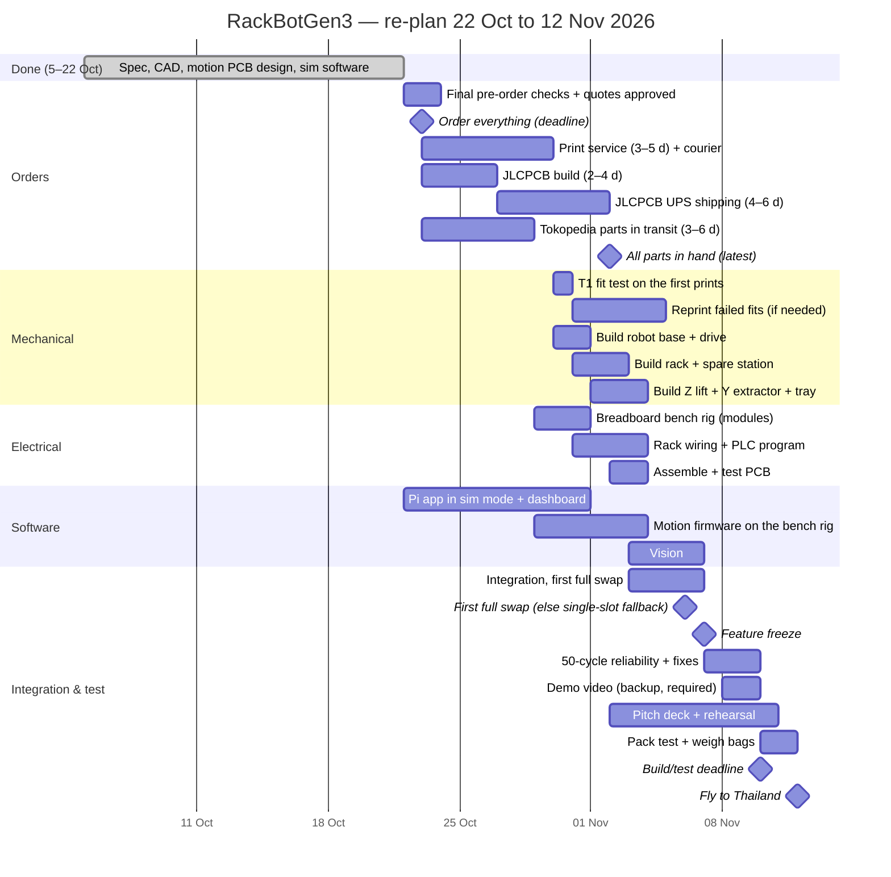

# RackBotGen3 — Plan, Budget, Tests & Risks

Status: Draft v0.1.28. Updated **Fri 23 Oct 2026** (parts fixes from the prototype review, §1). Build/test deadline **Tue 10 Nov**. Fly **Thu 12 Nov**. Final **Sat 14 Nov**.

---

## 1. Budget (USD, estimates)

Prices are typical AliExpress / local-store (Tokopedia) prices and **must be checked when ordering**. AliExpress parcels over USD 3 pay ≈ 30–40 % Indonesian import tax, so local is preferred unless much cheaper (see `docs/sourcing-options.md`).
The live, per-part order list is the Notion **Parts & Order List** database, mirrored in `docs/parts.csv` (IDs P01…); this section keeps the category totals. Shipping is assumed free or small (AliExpress Choice / local).

### 1.1 Robot — mechanical

| Item | Qty | USD |
|---|---|---|
| NEMA17 42×40, ≥ 0.4 N·m (Tokopedia) | 4 | 42 |
| 2020 V-slot 6 × 1 m (4.96 m of cuts + kerf) + 2040 V-slot 0.42 m (robot + rack + spare station), Lajarus Teknik | — | 23 |
| Mini V-wheels + 4 mini eccentric spacers, 4 plain 6 mm spacers, 10 shims 5 × 8 × 1 | 8 | 10 |
| Tr8×2 lead screw 350 + anti-backlash nut + coupler + KFL08 flange bearing | 1 | 7 |
| GT2 belt (Y axis), 20T, idler | set | 3 |
| Wheels 80 × 24 mm: printed PETG hub + TPU 95A tire (filament in §1.4) | 2 | 0 |
| Ball casters (2 rear + 1 anti-tip), printed spacers | 3 | 3 |
| MG90S servo (Tokopedia) | 3 | 4 |
| Lever microswitches KW11-3Z (12 + 3 spare) | 15 | 3 |
| Fastener kit (~120 M5 T-nuts, screws incl. 7 × M5×16 + 3 × M5×25 for the tray, 8 × M5×30 + nylocks for the V-wheel axles, ~48 corner brackets, M3 + ~60 M3 / ~15 M5 heat-set inserts) | — | 30 |
| Cable carrier (drag chain) 1 m, for the Z/Y harness | 1 | 2 |
| **Subtotal** | | **127** |

### 1.2 Robot — electronics

| Item | Qty | USD |
|---|---|---|
| Raspberry Pi 3 Model B+ (not team-owned after all, Tokopedia) | 1 | 70 |
| IMX708 120° camera board (Camera Module 3 **Wide** class, Tokopedia) | 1 | 37 |
| microSD 32 GB A1 | 1 | 8 |
| CSI flex cable 500 mm | 1 | 1 |
| ESP32-S3-DevKitC-1 (Tokopedia), 1 + 1 spare | 2 | 14 |
| TMC2209 StepStick (Tokopedia), 4 + 1 spare | 5 | 15 |
| Buck 5 V/5 A (XY-3606) + 2 × XL4015 CC/CV (charger, 5.8 V servo buck) | 3 | 4 |
| INA226 module + **10 mΩ / R010** 2512 shunt (local modules ship R100: swap it) | 1 | 2 |
| 18650 3.5 Ah × 4 + 4S BMS + holder/nickel strip | set | 33 |
| XT60/XT30, fuse holder, rocker switch, robot E-stop, silicone wire, JST-XH kit | set | 25 |
| Motion PCB, JLCPCB 5 pcs + Economic SMD assembly of 2 + shipping | 1 | 40 |
| Passives, headers, StepStick sockets, TVS, caps, WS2812, buzzer (itemised, Tokopedia) | set | 5 |
| USB-A to USB-C cable, 90° C plug (Pi → DevKit) | 1 | 2 |
| VMOT relay for the E-stop (12 V automotive, 30/40 A) + flyback diode | 1 | 2 |
| Harness extras: Pi micro-USB pigtail, servo/stepper extension leads, heat-shrink, Pi heatsink | set | 6 |
| JST-XH crimp tool (skip if the team has one) | 1 | 7 |
| **Subtotal** | | **271** |

### 1.3 Rack & spare station — electrical

| Item | Qty | USD |
|---|---|---|
| **Delta 24 V DIN-rail PSU, DRL-24V120W1EN (120 W)** | 1 | 39 |
| DIN rail, terminal blocks, 24 V relay module, UK5-HESI fuse terminal + 3.15 A fuse (CNC Store Bandung) | set | 5 |
| Status lamps: 3 × 22 mm 24 V panel indicators (R/Y/G) in a 3-hole box (replaces the tower light, v0.1.27) | 1 | 3 |
| Rack E-stop (2 NC contacts) | 1 | 3 |
| Dock contacts (pogo/brass), copper sheet, spare-station cables (4-core signal + 2-core dock power) | set | 9 |
| **Delta DVP-12SE11T PLC** | 1 | **not in budget, loan/sponsor** (≈ 150–250) |
| **ESP32 rack controller (PLC fallback, contingency; likely needed)**: DevKit + 8-ch 24 V opto inputs + 2 × dual MOSFET outputs + buck (02 §4.4) | set | 18 |
| Tethered power lead, 2 m + XT60 (battery fallback, R7) | 1 | 2 |
| **Subtotal** | | **79** |

### 1.4 Printing, demo materials & services

| Item | USD |
|---|---|
| PETG 2 kg | 36 |
| PLA 1 kg | 15 |
| TPU 95A 0.25 kg | 8 |
| Steel ballast + epoxy (dummy drives) | 8 |
| Tag/label printing, table mat | 10 |
| Claude Pro, 1 month (Rp360k) | 23 |
| **Subtotal** | **100** |

### 1.5 Total

| | USD |
|---|---|
| Robot mechanical | 127 |
| Robot electronics | 271 |
| Rack electrical | 79 (61 with the PLC loan) |
| Printing, demo & services | 100 |
| **Total** | **≈ 577** (of 500: **≈ 77 over**; ≈ 559 if the PLC loan comes through) |

**v0.1.28: ≈ 548 → ≈ 577 USD (≈ 77 over).** The prototype review (`docs/review/Corvin-project-review.pdf`, 23 Oct) found missing or short items: a spare ESP32-S3 DevKit (+7) and a 5th TMC2209 (+3, the shopping list already bought 5), M5×30 V-wheel axles + nylocks and the belt-clamp M3 (+2), a drag chain (+2), harness extras (+6), a JST-XH crimper (+7) and a tethered power lead (+2). Not counted yet: import duty on the motion PCB (≈ +10–13), and the print-service quote vs the filament lines below. **v0.1.27: the budget was ≈ 48 USD over** after buying the Raspberry Pi (+70), one month of Claude Pro (+23) and counting the ESP32 rack controller (+18), since PLC access now looks unlikely; dropping the travel router (−40, the Pi is the access point) and replacing the tower light with panel lamps (−5) took back 45. The savings options below recover ≈ 60–90 USD; otherwise the overrun needs the team's approval. Before that, the margin was ≈ 20 USD after the v0.1.12–v0.1.17 move to local (Tokopedia) suppliers, buying the travel router (v0.1.16) and JLCPCB SMD assembly of the motion board (v0.1.20); only the motion PCB (JLCPCB) is imported. **Savings options** (use them if prices come in higher, or a router must be bought):
wide-angle OV5647 camera instead of the IMX708 board (−29, more distortion) ·
team-owned filament or fasteners (−20 to −50) · drop the 3rd servo and spare switches (−5). Priced backup options and local (Tokopedia) sources: `docs/sourcing-options.md`.
**PLC**: request a loan from Delta Thailand this week. If none, buying a DVP12SE11T costs ≈ Rp2.6–3.3M (≈ 165–210 USD) on Tokopedia, which does not fit the budget, so use the ESP32 fallback rack controller (≈ +20 USD, see 02 §4.4) unless a sponsor covers it. **Pi 3**: not team-owned after all (23 Oct), so a 3B+ is bought (≈ Rp1.1M ≈ 70 USD, v0.1.27).

## 2. Schedule

Re-planned **Thu 22 Oct** (v0.1.24): nothing was ordered by the 8 Oct target, so every order goes out on **Fri 23 Oct**.
Lead times from the quotes received:

| Order | Quoted lead time | Ordered 23 Oct → in hand |
|---|---|---|
| 3D print service (all printed parts, one order) | Work 1–2 days fastest, 3–5 days slowest, **plus courier** (assumed ≈ 2 days, confirm with the shop) | 26–30 Oct |
| JLCPCB motion PCB + SMD assembly (P22) | 2–4 days work + 4–6 days UPS Worldwide | 29 Oct – 2 Nov (+ customs) |
| Tokopedia / Shopee (everything else) | Java sellers ≈ 3–6 days to Kuta | 26–29 Oct |

The bars below use the slow end of each quote; start a task as soon as its parts arrive.

Key rules:
- **Order everything on 23 Oct**, all printed parts in one print-service order with the v0.1.21 tolerances (no separate fit-test batch: there is no time for a second round trip before the build). Ask the shop to print the caddies, bay shelf and robot parts first. After the T1 fit test, reprint only the parts that fail.
- Ship the PCB by UPS as quoted. Until it arrives the robot runs from the breadboard bench rig (same pinout), so a late PCB does not block integration.
- Integration now has 4 days (was 6) and reliability testing 3 (was 5). **If there is no full swap by 6 Nov, switch to the single-slot fallback** (R9).
- Until parts arrive, software runs in sim mode.

## 3. Test protocol & acceptance criteria

| ID | Test | Pass criterion | When |
|---|---|---|---|
| T1 | Caddy fit in bay shelf and tray | Slides in/out by hand with ≤ 5 N, no binding, 10/10 | 30 Oct |
| T2 | Dummy drive mass | 600 ± 30 g, lid secure after a 1 m drop onto foam | 30 Oct |
| T3 | Z homing and holding | Repeatability ±0.1 mm (20×). 2 kg payload, unpowered, no creep in 10 min | 3–4 Nov |
| T4 | Y pull/push on bench | 20/20 pulls and pushes from a fixed bay, finger engages every time | 3–4 Nov |
| T5 | Drive accuracy | 500 mm straight: error < 10 mm. 180° turn: error < 3° (10×) | 1–3 Nov |
| T6 | Docking | Start 700 mm away, ±50 mm lateral, ±10° heading → 20/20 docks, X repeatability ±2 mm | 4–6 Nov |
| T7 | Bay fine-alignment | Residual Z error ≤ 1 mm after correction (20×) | 4–6 Nov |
| T8 | Vision performance | ≥ 8 fps at 640×480 on the Pi 3 while the dashboard streams | 3–6 Nov |
| T9 | PLC / rack | All I/O match the map. Watchdog trips in 2 ± 0.5 s. Dock power only with the spare-station dock switch + E-stop OK | 2–4 Nov |
| T10 | E-stop | Robot motion stops < 0.2 s. Mission recovers via re-home + resume | 4–6 Nov |
| T11 | **Full swap** | Cycle ≤ 3 min. **≥ 48/50 cycles** without manual intervention | 7–9 Nov |
| T12 | Battery & charging | 1 h continuous cycling, cells ≥ 3.5 V. Charging confirmed on the spare-station dock (I < 0) | 7–9 Nov |
| T13 | Dashboard | All views live on a laptop + phone. Fault injection → auto job → bay OK | 5–9 Nov |
| T14 | **Pack test** | Every bag ≤ 7 kg incl. personal items. Reassembly ≤ 20 min + calibration ≤ 10 min from a written checklist | 10–11 Nov |

Log every swap (timestamp, result, cycle time, Wh) in SQLite. The data goes into the pitch (reliability and energy charts).

## 4. Risk register

| # | Risk | L | I | Mitigation / fallback |
|---|---|---|---|---|
| R1 | Parts arrive late | H | H | Order everything on 23 Oct (all local except the PCB), work to the slow end of each quote, local suppliers for motors/extrusion, 1 spare of each cheap part |
| R2 | PCB late or faulty | M | M | Perfboard build of the same schematic and pinout. Breadboard bench rig from 29 Oct runs the robot until the PCB arrives (latest 2 Nov) |
| R3 | No PLC available | M | M | ESP32 rack controller with the identical Modbus map (02 §4.4). Delta PSU stays as the Delta part |
| R4 | Docking unreliable | M | H | Mechanical funnel does the fine work. Slow final approach. Automatic retries. Tune 4–6 Nov |
| R5 | Caddy binds in bay or tray | M | H | Lead-ins, print-service tolerances (v0.1.21), T1 fit test on 30 Oct and reprint only what fails, sand or PTFE tape, adjust `Z_*_OFFSET` |
| R6 | Pi 3 vision too slow | L | M | ROI crop, decimate, lower approach speed. Fallback: a Pi 4 borrowed or bought |
| R7 | Battery issue at the airport | L | H | 50 Wh labeled, datasheet printed, in cabin. **Fallback: tethered power** from the rack PSU (2 m lead into the charger input, ≈ 25 W) |
| R8 | Transport damage | M | H | Padded packing, spare printed parts (fingers, nose, shelf), spare servos/switches, STL files on a laptop |
| R9 | Integration overrun | H | H | Sim-first software. Feature freeze 7 Nov. **Single-slot fallback** (two trips, same hardware) if there is no full swap by 6 Nov |
| R10 | Scope creep | M | M | One owner per subsystem. Stretch goals (MQTT, auto-charge tuning, HMI) only after T11 passes |

## 5. Airline & travel checklist

- [ ] **Battery**: 4S1P 18650 = 50.4 Wh (< 100 Wh, no airline approval needed). **Carry-on only**, Wh written on the pack, XT60 capped, in a LiPo bag. Printed cell datasheet and Wh calculation.
- [ ] No spare loose cells. If spares are needed, buy in Thailand or bring at most 2, each in a separate case.
- [ ] Check each member's airline: 7 kg and 56 × 36 × 23 cm (AirAsia-type limits are the strictest).
- [ ] Tools: no knives, cutters or scissors. Screwdrivers and wrenches over ~7 cm are banned on some airlines. Bring short hex keys and bits only, or buy a cheap screwdriver set in Thailand.
- [ ] No butane soldering iron. Leave the soldering iron at home or put it in checked baggage.
- [ ] One-page device description ("educational robot prototype for Delta Cup 2026, no hazardous materials") + Delta invitation letter for security and customs.
- [ ] Thailand mains 220 V / 50 Hz, sockets A/B/C/O. The Delta PSU is universal input. Bring 2 plug adapters and a power strip.
- [ ] Pi access point SSID `RACKBOT` and IPs unchanged. Dashboard tested offline (no internet needed).
- [ ] Laptop with: STL files, firmware build, Pi SD card image backup, ISPSoft project, demo video (backup), pitch deck.
- [ ] National flag (required by the guidebook) + university flag.
- [ ] Reassembly and calibration checklist printed.
