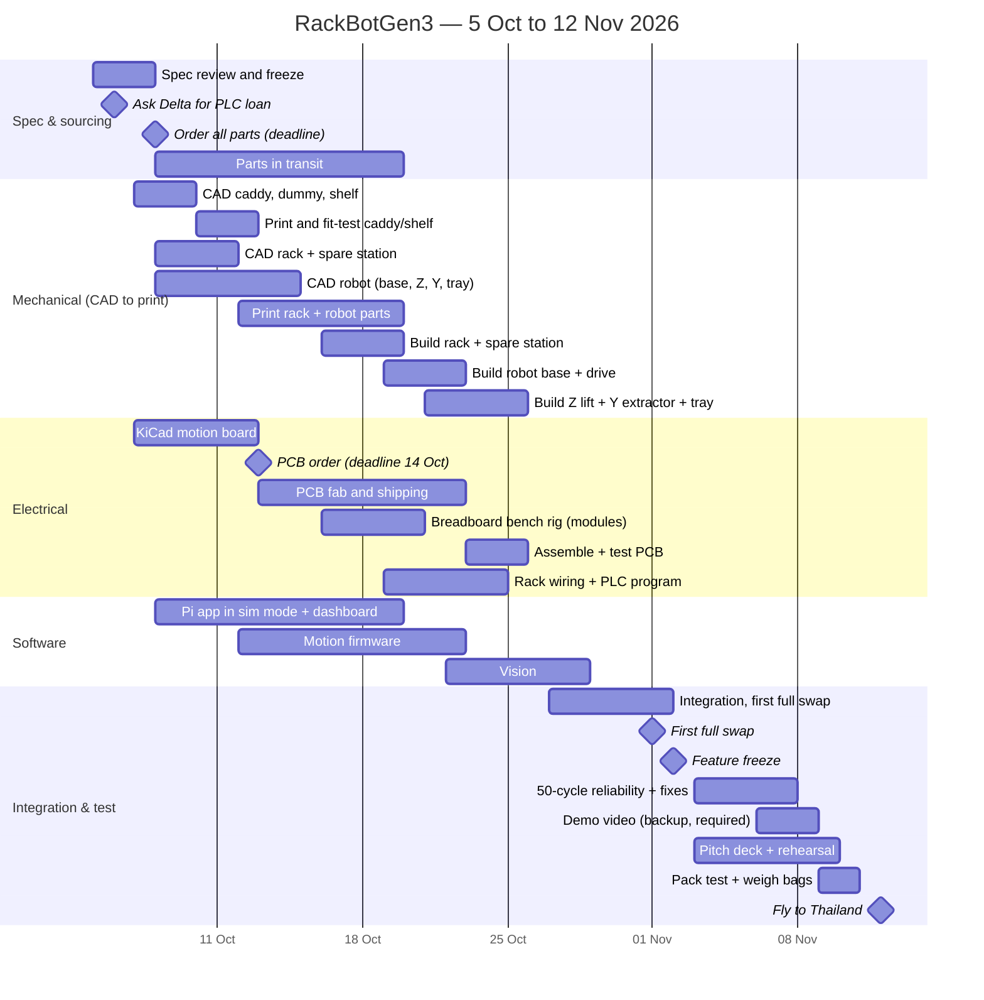

# RackBotGen3 — Plan, Budget, Tests & Risks

Status: Draft v0.1. Today: **Mon 5 Oct 2026**. Build/test deadline **Tue 10 Nov**. Fly **Thu 12 Nov**. Final **Sat 14 Nov**.

---

## 1. Budget (USD, estimates)

Prices are typical AliExpress / local-store (Tokopedia) prices and **must be checked when ordering**. AliExpress parcels over USD 3 pay ≈ 30–40 % Indonesian import tax, so local is preferred unless much cheaper (see `docs/sourcing-options.md`).
The live, per-part order list is the Notion **Parts & Order List** database, mirrored in `docs/parts.csv` (IDs P01…); this section keeps the category totals. Shipping is assumed free or small (AliExpress Choice / local).

### 1.1 Robot — mechanical

| Item | Qty | USD |
|---|---|---|
| NEMA17 42×40, ≥ 0.4 N·m (Tokopedia) | 4 | 42 |
| 2020 V-slot 6 × 1 m (4.96 m of cuts + kerf) + 2040 V-slot 0.42 m (robot + rack + spare station), Lajarus Teknik | — | 23 |
| Mini V-wheel kits | 8 | 8 |
| Tr8×2 lead screw 350 + anti-backlash nut + coupler + KFL08 flange bearing | 1 | 7 |
| GT2 belt (Y axis), 20T, idler | set | 3 |
| Wheels 80 × 24 mm: printed PETG hub + TPU 95A tire (filament in §1.4) | 2 | 0 |
| Ball casters (2 rear + 1 anti-tip), printed spacers | 3 | 3 |
| MG90S servo (Tokopedia) | 3 | 4 |
| Lever microswitches KW11-3Z (13 + 2 spare) | 15 | 3 |
| Fastener kit (~120 M5 T-nuts, screws incl. 7 × M5×16 + 3 × M5×25 for the tray, ~48 corner brackets, M3 + ~60 M3 / ~15 M5 heat-set inserts) | — | 28 |
| **Subtotal** | | **121** |

### 1.2 Robot — electronics

| Item | Qty | USD |
|---|---|---|
| Raspberry Pi 3B/3B+ | 1 | 0 (team-owned) |
| IMX708 120° camera board (Camera Module 3 **Wide** class, Tokopedia) | 1 | 37 |
| microSD 32 GB A1 | 1 | 8 |
| CSI flex cable 500 mm | 1 | 1 |
| ESP32-S3-DevKitC-1 (Tokopedia) | 1 | 7 |
| TMC2209 StepStick (Tokopedia) | 4 | 12 |
| Buck 5 V/5 A + buck 6 V/3 A + CC/CV charger module | 3 | 4 |
| INA226 module + **10 mΩ / R010** 2512 shunt (local modules ship R100: swap it) | 1 | 2 |
| 18650 3.5 Ah × 4 + 4S BMS + holder/nickel strip | set | 33 |
| XT60/XT30, fuse holder, rocker switch, robot E-stop, silicone wire, JST-XH kit | set | 25 |
| Motion PCB, JLCPCB 5 pcs + shipping | 1 | 25 |
| Passives, headers, StepStick sockets, TVS, caps, WS2812, buzzer (itemised, Tokopedia) | set | 5 |
| USB-A to USB-C cable, 90° C plug (Pi → DevKit) | 1 | 2 |
| VMOT relay for the E-stop (12 V automotive, 30/40 A) + flyback diode | 1 | 2 |
| **Subtotal** | | **163** |

### 1.3 Rack & spare station — electrical

| Item | Qty | USD |
|---|---|---|
| **Delta 24 V DIN-rail PSU, 75–100 W** | 1 | 35 |
| DIN rail, terminal blocks, 24 V relay module, polyfuse (CNC Store Bandung) | set | 5 |
| 24 V mini tower light R/Y/G | 1 | 8 |
| Rack E-stop (2 NC contacts) | 1 | 3 |
| 24 → 5 V USB buck (router) | 1 | 2 |
| Dock contacts (pogo/brass), copper sheet, spare-station cable | set | 8 |
| Travel router GL.iNet GL-MT300N-V2 (not owned; Tokopedia) | 1 | 38 |
| **Delta DVP-12SE11T PLC** | 1 | **not in budget, loan/sponsor** (≈ 150–250) |
| **Subtotal** | | **99** |

### 1.4 Printing & demo materials

| Item | USD |
|---|---|
| PETG 2 kg | 36 |
| PLA 1 kg | 15 |
| TPU 95A 0.25 kg | 8 |
| Steel ballast + epoxy (dummy drives) | 8 |
| Tag/label printing, table mat | 10 |
| **Subtotal** | **77** |

### 1.5 Total

| | USD |
|---|---|
| Robot mechanical | 121 |
| Robot electronics | 163 |
| Rack electrical | 99 |
| Printing & demo | 77 |
| **Total** | **≈ 460** (of 500) |

The margin is ≈ 40 USD after the v0.1.12–v0.1.17 move to local (Tokopedia) suppliers and buying the travel router (v0.1.16); only the motion PCB (JLCPCB) is imported. **Savings options** (use them if prices come in higher, or a router must be bought):
wide-angle OV5647 camera instead of the IMX708 board (−29, more distortion) ·
3 panel LEDs instead of the tower light (−7) · team-owned filament or fasteners (−20 to −50) · drop the 3rd servo and spare switches (−5). Priced backup options and local (Tokopedia) sources: `docs/sourcing-options.md`.
**PLC**: request a loan from Delta Thailand this week. If none, buying a DVP12SE11T costs ≈ Rp2.6–3.3M (≈ 165–210 USD) on Tokopedia, which does not fit the budget, so use the ESP32 fallback rack controller (≈ +20 USD, see 02 §4.4) unless a sponsor covers it. **Pi 3**: team-owned; a replacement 3B+ is ≈ Rp1.1M (≈ 70 USD).

## 2. Schedule

Key rule: **order everything by 8 Oct**. Buy motors, extrusion and fasteners locally if AliExpress delivery is quoted at more than 10 days.
Until parts arrive, software runs in sim mode and mechanical fit is tested with printed parts only.

## 3. Test protocol & acceptance criteria

| ID | Test | Pass criterion | When |
|---|---|---|---|
| T1 | Caddy fit in bay shelf and tray | Slides in/out by hand with ≤ 5 N, no binding, 10/10 | W1–W2 |
| T2 | Dummy drive mass | 600 ± 30 g, lid secure after a 1 m drop onto foam | W2 |
| T3 | Z homing and holding | Repeatability ±0.1 mm (20×). 2 kg payload, unpowered, no creep in 10 min | W3 |
| T4 | Y pull/push on bench | 20/20 pulls and pushes from a fixed bay, finger engages every time | W3 |
| T5 | Drive accuracy | 500 mm straight: error < 10 mm. 180° turn: error < 3° (10×) | W3 |
| T6 | Docking | Start 700 mm away, ±50 mm lateral, ±10° heading → 20/20 docks, X repeatability ±2 mm | W4 |
| T7 | Bay fine-alignment | Residual Z error ≤ 1 mm after correction (20×) | W4 |
| T8 | Vision performance | ≥ 8 fps at 640×480 on the Pi 3 while the dashboard streams | W3–W4 |
| T9 | PLC / rack | All I/O match the map. Watchdog trips in 2 ± 0.5 s. Dock power only with dock + E-stop OK | W3–W4 |
| T10 | E-stop | Robot motion stops < 0.2 s. Mission recovers via re-home + resume | W4 |
| T11 | **Full swap** | Cycle ≤ 3 min. **≥ 48/50 cycles** without manual intervention | W5 |
| T12 | Battery & charging | 1 h continuous cycling, cells ≥ 3.5 V. Charging confirmed on dock (I < 0) | W5 |
| T13 | Dashboard | All views live on a laptop + phone. Fault injection → auto job → bay OK | W4–W5 |
| T14 | **Pack test** | Every bag ≤ 7 kg incl. personal items. Reassembly ≤ 20 min + calibration ≤ 10 min from a written checklist | W5 |

Log every swap (timestamp, result, cycle time, Wh) in SQLite. The data goes into the pitch (reliability and energy charts).

## 4. Risk register

| # | Risk | L | I | Mitigation / fallback |
|---|---|---|---|---|
| R1 | Parts arrive late | H | H | Order by 8 Oct, local suppliers for motors/extrusion, 1 spare of each cheap part |
| R2 | PCB late or faulty | M | M | Perfboard build of the same schematic and pinout. Breadboard bench rig from W2 |
| R3 | No PLC available | M | M | ESP32 rack controller with the identical Modbus map (02 §4.4). Delta PSU stays as the Delta part |
| R4 | Docking unreliable | M | H | Mechanical funnel does the fine work. Slow final approach. Automatic retries. Tune in W4 |
| R5 | Caddy binds in bay or tray | M | H | Lead-ins, fit test in W1–W2 before printing everything, sand or PTFE tape, adjust `Z_*_OFFSET` |
| R6 | Pi 3 vision too slow | L | M | ROI crop, decimate, lower approach speed. Fallback: a Pi 4 borrowed or bought |
| R7 | Battery issue at the airport | L | H | 50 Wh labeled, datasheet printed, in cabin. **Fallback: tethered power** from the rack PSU (2 m lead into the charger input, ≈ 25 W) |
| R8 | Transport damage | M | H | Padded packing, spare printed parts (fingers, nose, shelf), spare servos/switches, STL files on a laptop |
| R9 | Integration overrun | H | H | Sim-first software. Feature freeze 2 Nov. **Single-slot fallback** (two trips, same hardware) |
| R10 | Scope creep | M | M | One owner per subsystem. Stretch goals (MQTT, auto-charge tuning, HMI) only after T11 passes |

## 5. Airline & travel checklist

- [ ] **Battery**: 4S1P 18650 = 50.4 Wh (< 100 Wh, no airline approval needed). **Carry-on only**, Wh written on the pack, XT60 capped, in a LiPo bag. Printed cell datasheet and Wh calculation.
- [ ] No spare loose cells. If spares are needed, buy in Thailand or bring at most 2, each in a separate case.
- [ ] Check each member's airline: 7 kg and 56 × 36 × 23 cm (AirAsia-type limits are the strictest).
- [ ] Tools: no knives, cutters or scissors. Screwdrivers and wrenches over ~7 cm are banned on some airlines. Bring short hex keys and bits only, or buy a cheap screwdriver set in Thailand.
- [ ] No butane soldering iron. Leave the soldering iron at home or put it in checked baggage.
- [ ] One-page device description ("educational robot prototype for Delta Cup 2026, no hazardous materials") + Delta invitation letter for security and customs.
- [ ] Thailand mains 220 V / 50 Hz, sockets A/B/C/O. The Delta PSU is universal input. Bring 2 plug adapters and a power strip.
- [ ] Wi-Fi router SSID and IPs unchanged. Dashboard tested offline (no internet needed).
- [ ] Laptop with: STL files, firmware build, Pi SD card image backup, ISPSoft project, demo video (backup), pitch deck.
- [ ] National flag (required by the guidebook) + university flag.
- [ ] Reassembly and calibration checklist printed.
