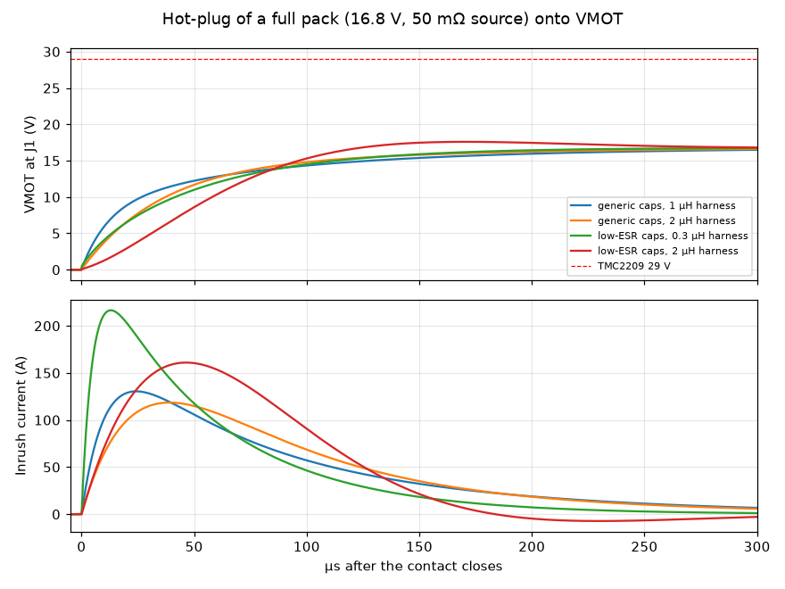
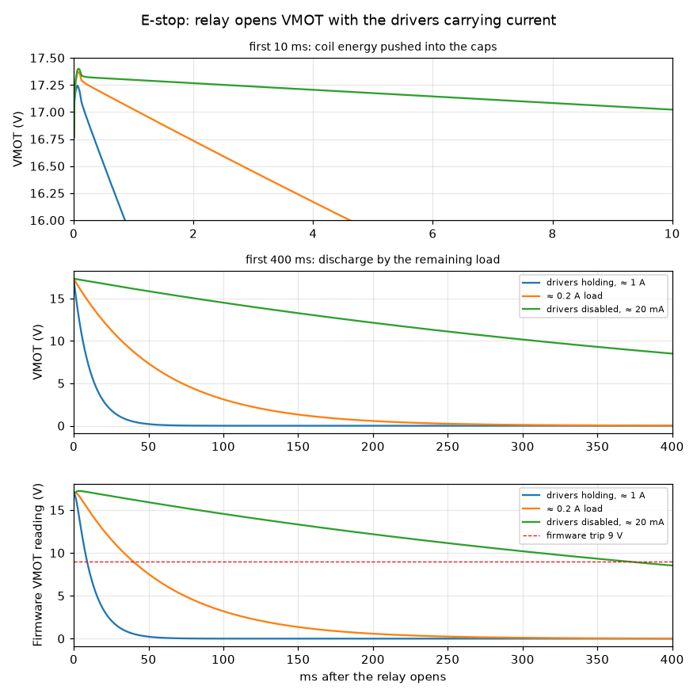
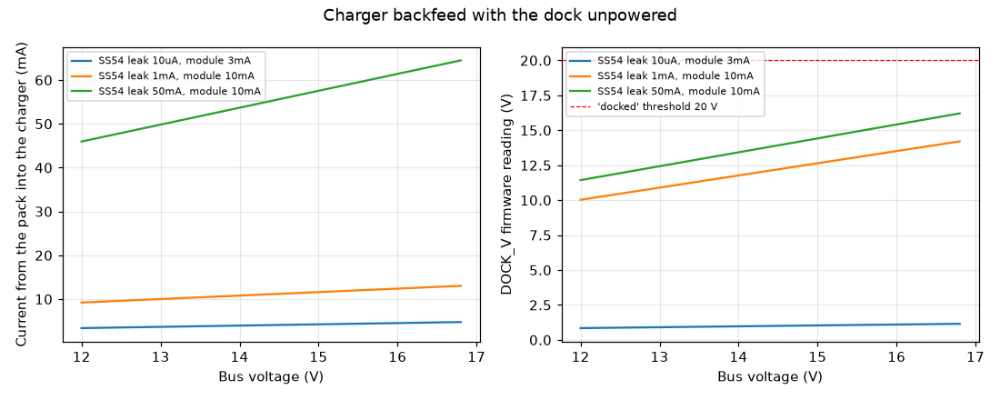
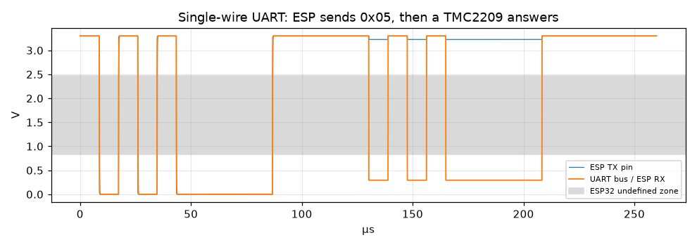

# RBG3-MOTION: SPICE checks of the power path

These simulate the parts of the robot's power path that a layout check can't verify. The bought modules (XL4015
charger, BMS, TMC2209) have no SPICE models, so each one is reduced to a simple equivalent circuit. The
assumptions are listed at the top of each `.cir` file.

Run with `sim/run.sh` (from `pcb/motion-board/`). It uses the ngspice library bundled with KiCad 10, so nothing
needs installing. It also works with an `ngspice` binary on PATH, or with `NGSPICE_LIB` set. It writes
[`results.md`](results.md) (the full table) and `plots/`, and exits 1 if any check fails. Raw data goes to `sim/build/`
(gitignored).

| File | Circuit | Review question |
|---|---|---|
| `hotplug.cir` | A full pack switched onto the empty VMOT capacitors (XT30 plug-in, main switch, or E-stop relay release) | Q5, Q9 |
| `estop.cir` | E-stop relay opens VMOT while all drivers carry current | Q4 |
| `backfeed.cir` | Dock unpowered: the bus feeds back into the charger module and the dock pads | Q1 |
| `signals.cir` | VMOT_SENSE / DOCK_V dividers vs the ADC range; single-wire UART through R6 1 k | Q10, Q11 |

## Results (spec v0.1.19)

All checks pass. The details are in [`results.md`](results.md).

| Check | Result | Limit |
|---|---|---|
| VMOT overshoot when a full pack is switched on | Overdamped: peak 16.8 V with generic capacitors, 17.6 V with low-ESR ones (2 µH harness). TVS never conducts | < 29 V |
| VMOT rise when the E-stop opens with all coils carrying current | +0.6 V (peak 17.4 V). TVS never conducts | < 29 V |
| Charger backfeed, DOCK_V false "docked" | DOCK_V reads at most 16.2 V | < 20 V |
| VMOT_SENSE / DOCK_V full scale | 19.0 V / 31.9 V (2.56 V at 16.8 V, 2.18 V at 24 V) | ≤ 2.9 V ADC |
| UART edge through 1 k | 146 ns rise (1.7 % of a bit). A TMC reply reads 0.29 V low against the idle-high TX | ESP32 VIL 0.83 V |

## What the results mean

1. **Hot-plug: no overvoltage, but a big inrush.** The 870 µF of electrolytics and the 50–150 mΩ pack
   resistance make the circuit overdamped. The loop impedance √(L/C) is only 20–50 mΩ, so VMOT doesn't ring;
   it creeps up to 16.8 V. The SMBJ18A never conducts.
   - The inrush is 120–220 A for about 100 µs (I²t ≈ 1–2 A²s), every time the main switch closes or the E-stop
     is released.
   - Two things to **check on the bench**:
     - **The BMS short-circuit protection may trip.** Typical 4S BMS settings are 50–200 A with a 100–300 µs
       delay. If it trips at switch-on, add a pre-charge (an NTC or a resistor bypassed by the switch).
     - **The 7.5 A fuse** must have a melting I²t comfortably above 2 A²s. Check the datasheet of the fuse you
       bought.
   - This also argues **against swapping in low-ESR or ceramic bulk capacitors**: they raise the inrush and
     reduce the damping.
2. **E-stop: the coil energy is harmless.** The motors store about 7 mJ in total (L · Irms², the four run
   currents). Dumped into 700 µF (870 µF at −20 %), that gives +0.6 V within 0.15 ms. The hand calculation
   gives 17.41 V; SPICE gives 17.40 V.
   - Adding the Z rotor's kinetic energy by hand (≈ 54 g·cm², typical for a 40 mm NEMA17, at 450 rpm, about
     6 mJ) brings the worst case to about 17.9 V. That's still far below 29 V.
   - Back-EMF can't pump the bus. At 150 mm/s cruise the wheel motors turn at 36 rpm and make about 1 V.
     Even pushing the robot by hand at 1 m/s gives about 6 V, below the 12 V pack minimum.
     (Kt ≈ 0.41 N·m / 1.7 A ≈ 0.24 V·s/rad.)
   - **The E-stop is detected slowly when the drivers are disabled.** VMOT_SENSE < 9 V takes 9 ms with the
     drivers holding (≈ 1 A), 40 ms at 0.2 A, and about 370 ms with the drivers disabled (≈ 20 mA left on
     VMOT).
   - Safety isn't affected, because the motors lose power the moment the relay opens. But the backlog test
     "E-stop drops VMOT within 50 ms" only holds with the drivers enabled. Run test T10 that way, or add a
     load on VMOT if a faster report is wanted.
   - **v0.1.25:** the button's NO contact now goes to J13 (AUX_IN), so the firmware reports a press at once,
     drivers enabled or not; VMOT_SENSE stays as the backup.
3. **Backfeed: no diode needed for correct function, but the pack is drained slightly.**
   - With the dock unpowered, the bus feeds the module's VIN side (worst case, through the body diode of the
     XL4015's internal switch) and its feedback divider. That draws **5–13 mA** (0.1–0.2 W, 2–5 % of the 4 W
     idle load).
   - Right after a charge the SS54 is hot. At its datasheet maximum leakage (50 mA at 100 °C) the drain rises
     to about 65 mA.
   - There's no drain with the main switch off, because the charger output is after the switch.
   - The dock pads can float up to about 16 V while undocked. That's harmless, since only the leakage current
     can flow.
   - **DOCK_V can't fake "docked":** the pad side can never rise above the bus (≤ 16.8 V), and the threshold is 20 V.
   - A series diode or ideal diode at the charger output would remove the drain. It isn't needed for correct
     function.
4. **The dividers and the UART are fine.** The values match CROSSCHECK, and the 1 k UART resistor adds a
   negligible RC delay.

## What is not simulated
- The bought modules' behaviour: the XL4015's CC loop and stability, the BMS protection thresholds, and the
  TMC2209 chopper. All three are measured at bring-up (`../README.md`, Assembly and bring-up checklist).
- Relay contact bounce and arcing, and ESD on the switch and dock-pad lines.
- Trace heating (IPC-2152) and the PCB's own parasitics. Those are covered by the layout rules (1.0 mm VMOT,
  GND pours), not by these netlists.
